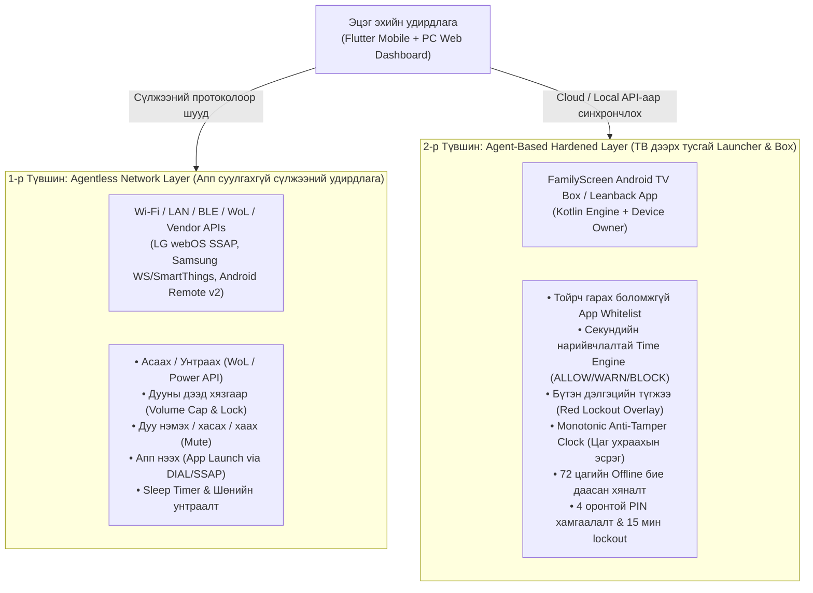

# FAMILYSCREEN — Product Requirements Document (PRD)

| Талбар | Утга |
|---|---|
| **Version** | 2.0 (Universal TV Control & Multi-Device Parental Platform) |
| **Төлөв** | Батлагдсан Стратегийн Архитектур |
| **Зах зээл** | Монгол Улс & Олон улсын зах зээл |
| **Үндсэн хэл** | Монгол |
| **Бүтээгдэхүүн** | Universal TV Control & Parental Digital Wellbeing System |
| **Бизнес загвар** | Freemium (SaaS) + Hardware/Agent (FamilyScreen Box) |
| **Удирдлагын платформ** | Flutter Mobile App (iOS / Android) + PC Web Dashboard |
| **Дэмжигдэх ТВ экосистем** | Android TV / Google TV, Samsung Tizen, LG webOS, Roku, Generic Smart TVs |

---

# 1. Бүтээгдэхүүний танилцуулга ба Алсын хараа

## 1.1. Бүтээгдэхүүний нэр
**FamilyScreen — Universal TV Control & Parental Management**

## 1.2. Алсын хараа (Vision)
Бүх төрлийн ухаалаг зурагтыг (Android TV, Samsung Tizen, LG webOS гэх мэт) эцэг эхийн гар утас болон суурин компьютерээс нэгдсэн байдлаар алсаас удирдах, дууны түвшний дээд хязгаар тогтоох, цагийн хуваариар хянах, эрүүл дижитал хэрэглээг төлөвшүүлэх бүх нийтийн ухаалаг систем.

## 1.3. Эрхэм зорилго (Mission)
- **Нэгдсэн удирдлага:** Айлын зочны болон хүүхдийн өрөөний ялгаатай брэндийн зурагтуудыг нэг апп болон компьютерээс хялбар удирдах.
- **Эрүүл сонсгол ба тав тух:** Хүүхэд зурагтын дууг хэт чангалан чихээ гэмтээх, гэр бүлийн амгалан байдлыг алдагдуулахаас сэргийлж дууны дээд хязгаар (Volume Cap) тогтоох.
- **Дэлгэцийн цагийн хатуу хамгаалалт:** Хэт их үзэлтээс сэргийлж ухаалаг хуваарь, апп whitelist, оффлайн хамгаалалттай Time Engine ажиллуулах.
- **Хялбар эхлэл (Agentless First):** ТВ дээр нэмэлт апп суулгахгүйгээр Wi-Fi/LAN сүлжээгээр шууд асаах, унтраах, дуу удирдах, харин хүүхэд тойрч гарахгүй хатуу хяналтад зориулан тусгай Launcher/Box ашиглах хосолмол бүтэц бүрдүүлэх.

## 1.4. Шийдвэрлэх асуудлууд
1. **Зурагт бүрт өөр өөр пульт ашиглах төвөг:** Samsung, LG, Android TV-д зориулсан тусдаа удирдлага хайх, баттерей дуусах.
2. **Дууны хяналтгүй байдал:** Хүүхэд зурагтын дууг 80-100% тултал чангалж сонсгол муутгах, гэрийнхнийг тавгүйтүүлэх.
3. **Хяналтгүй цаг зарцуулалт:** Хүүхдүүд шөнө орой болтол YouTube, тоглоом үзэх.
4. **Удирдах хэрэгслийн хязгаарлагдмал байдал:** Эцэг эх зөвхөн утсаар биш, ажлынхаа компьютерээс (Web Dashboard) гэрийнхээ ТВ-г хянах хэрэгцээ.
5. **Техникийн хаалтууд:** Бүх зурагт нэг ижил үйлдлийн системгүй (Android, Tizen, webOS) тул нэг төрлийн суулгац бүх төхөөрөмжид ажиллах боломжгүй байдаг.

---

# 2. Хоёр Шатлалт Бүтэц ба Хяналтын Зарчим (Two-Tier Enforcement Architecture)

FamilyScreen нь **"ТВ дээр апп суулгахгүйгээр боломжтой бүх удирдлагыг эхэлж олгох, харин тойрч гарахгүй хатуу хяналтад төхөөрөмжийн апп ашиглах"** алтан дүрмийг баримтална.



---

# 3. Зорилтот Платформ ба Төхөөрөмжийн Матриц

| Платформ / ТВ брэнд | 1-р Түвшин: Сүлжээний удирдлага (Аппгүй) | 2-р Түвшин: Хатуу хяналт (Тусгай Launcher/Agent) | Холболтын технологи |
|---|---|---|---|
| **Android TV / Google TV** (Sony, TCL, Mi TV, Chromecast) | Дуу (Vol+/Vol-), Асаах/Унтраах, D-Pad | **БҮРЭН ДЭМЖИГДСЭН** (FamilyScreen Kotlin App) | Android TV Remote Protocol v2 (TLS 6466/6467) |
| **FamilyScreen TV Box** (Одоогийн бэлэн шийдэл) | Дуу, Асаах/Унтраах, D-Pad | **БҮРЭН ДЭМЖИГДСЭН** (Custom Kiosk Launcher & Monotonic Engine) | Local Engine + SQLite + WebSocket + REST |
| **Samsung Smart TV (Tizen 2016+)** | Дуу (Vol+/Vol- товчлуур), Асаах/Унтраах, Launch, D-Pad (Volume Cap зөвхөн SmartThings Cloud-аар) | Tizen WGT Web App (Хязгаарлагдмал sandbox) | Samsung WebSocket Port 8001/8002 + SmartThings API + WoL |
| **LG Smart TV (webOS 3.0+)** | Дууны хувь тохируулах, Volume Cap, Асаах/Унтраах, Launch, D-Pad | webOS IPK App (Хязгаарлагдмал sandbox) | LG webOS SSAP WebSocket Port 3000/3001 + WoL |
| **Roku TV** | Дуу (Vol+/Vol-), Асаах/Унтраах, Апп нээх, D-Pad | Дэмжигдэхгүй (Roku sandbox) | Roku ECP (External Control Protocol HTTP POST 8060) |
| **Бусад Smart TV / Дэлгэц** | Дууг хаах, Media Pause, Power Off | Android TV Box залгаж ашиглах | UPnP / DLNA / HDMI-CEC / Wake-on-LAN |

---

# 4. Бүтээгдэхүүний Функцийн Шаардлагууд (Functional Requirements)

### 4.1. Universal Remote & Volume Management (Сүлжээний түвшин)
- **FR-12: Автомат сүлжээний төхөөрөмж илрүүлэлт (Device Discovery):** Утас эсвэл компьютер гэрийн Wi-Fi сүлжээнд байгаа Smart TV-үүдийг mDNS, SSDP, UPnP ашиглан автоматаар илрүүлж нэрээр нь жагсаана.
- **FR-13: Дууны түвшний дээд хязгаар (Volume Max Cap - Платформоос хамааралтай):**
  - Дэмждэг платформууд (LG webOS WebSocket, Samsung SmartThings, болон FamilyScreen TV Box) дээр дууны дээд хязгаар тогтоож, хүүхэд пультээр чангалахад буцааж хязгаарт нь татна.
  - *Техникийн бодит байдал:* Энэ нь сүлжээний хоцрогдолтой хариу үйлдэлтэй хяналт (Reactive) тул төхөөрөмж дээрх FamilyScreen Agent шиг агшин зуурын 0-хоцрогдолтой механик түгжээ биш гэдгийг тодорхой заана.
- **FR-14: Шууд алсын удирдлага (Universal Remote):** Утас болон PC-ээс Дуу чангалах/суллах, Хаах (Mute), Суваг/Оролт солих, D-Pad сумтай удирдлага хийх.
- **FR-15: Алсаас Асаах ба Унтраах (Power Management):** ТВ дэмждэг бол Wake-on-LAN (WoL) болон үйлдвэрлэгчийн API-аар алсаас асаах, шөнө унтах цаг болоход автоматаар унтраах.

### 4.2. Parental Digital Wellbeing & Time Engine (Хатуу хяналтын түвшин — Agent шаардана)
*Анхааруулга: Доорх хатуу хяналтын дүрмүүд (FR-04-өөс FR-10) нь хүүхэд тойрч гарах боломжгүйгээр хэрэгжихэд төхөөрөмжийн түвшний FamilyScreen Agent (Android TV Box) шаардагдана. Апп суулгаагүй Smart TV-д зөвхөн сүлжээгээр унтраах (Power Off) болон дуу хаах (Mute) хэлбэрээр хэсэгчлэн үйлчилнэ.*
- **FR-01: Authentication:** Эцэг эхийн бүртгэл, нууц үг сэргээх, Supabase JWT / Session удирдлага.
- **FR-02: Child Profiles:** Хүүхдийн нэр, насны ангилал, өдрийн лимит, хувийн дүрмүүд.
- **FR-03: Multi-Device Binding:** Нэг айл олон өрөөний олон төрлийн ТВ (Android Box + Samsung + LG)-г нэг аккаунтад холбох.
- **FR-04: Daily Screen Quota:** Өдрийн хэрэглээний лимит (ажлын өдөр ба амралтын өдрийн бонус цаг).
- **FR-05: Weekly Time Schedules:** Хичээлийн өдөр болон амралтын өдрөөр зурагт үзэж болох цагийн цонх.
- **FR-06: 3-Level Warnings:** Хугацаа дуусахаас 15м, 5м, 1м өмнө дэлгэц дээр сэрэмжлүүлэх.
- **FR-07: Parent Instant Lock:** Эцэг эх гар утас эсвэл компьютерээсээ нэг товч дараад бүх ТВ-ийг шууд унтраах эсвэл блоклох.
- **FR-08: Secure PIN Override:** Тохируулсан 4 оронтой нууц кодоор 5, 10, 15, 30 минут сунгах, 5 удаа буруу оруулбал 15 минут түгжих.
- **FR-09: Offline Autonomous Engine:** Интернэт тасарсан ч Android TV төхөөрөмж өөрийн монотон цагаар хяналтаа 72 цаг найдвартай үргэлжлүүлэх.
- **FR-10: Strict App Whitelist:** Зөвхөн зөвшөөрөгдсөн боловсрол, хүүхдийн аппыг нээх, бусдыг хаах.
- **FR-11: Cross-Device Usage Analytics:** Хүүхэд өдөрт, 7 хоногт, сард аль ТВ дээр ямар апп хэдэн минут үзсэнийг нэгтгэн харуулах.

### 4.3. PC Web Dashboard (Компьютерийн Нэгдсэн Удирдлага)
- **FR-16: Web Dashboard:** Хөтөч дээрээс (Chrome, Edge, Safari) шууд нэвтэрч гэрийн бүх зурагтуудын одоогийн төлөв (асаалттай эсэх, ямар апп ажиллаж буй, үлдсэн хугацаа, дууны түвшин)-ийг бодит цагт хянах, тохируулах.

---

# 5. Хэрэглэгчийн Дэлгэц ба Ашиглалтын Урсгал (User Flows)

```
[Эцэг эх: Апп / Вэб нээх]
       │
       ▼
[Автомат хайлт: Гэрийн Wi-Fi дээрх ТВ-үүдийг илрүүлэх]
       │
       ├──► 1. Android TV / Box олдвол ──► "FamilyScreen Agent суулгаж хатуу хяналт тавих уу?"
       │                                     └── Тийм: App Whitelist + Monotonic Time Engine
       │                                     └── Үгүй: Сүлжээгээр дуу, асаах/унтраах удирдах
       │
       ├──► 2. Samsung Smart TV олдвол ──► "ТВ дэлгэц дээр зөвшөөрөх товч дарна уу" ──► Сүлжээний удирдлага холбогдоно
       │
       └──► 3. LG webOS TV олдвол ───────► "ТВ дэлгэц дээр гарсан 8 оронтой кодыг оруулна уу" ──► Сүлжээний удирдлага холбогдоно
```

---

# 6. Хөгжүүлэлтийн Үе Шатны Роудмап (Roadmap)

| Үе шат | Хүрээ | Гол үр дүн | Төлөв |
|---|---|---|---|
| **Phase 1–10.1** | Android TV Box & Core System | Backend, Flutter суурь, 34 Kotlin тест, Monotonic Engine, CI 100% | **БҮРЭН ДУУССАН** 🟢 |
| **Phase 11** | Universal Architecture & DB Migration | PRD v2.0, Architecture v2.0, Multi-device schema өргөтгөл | **ОДОО ХЭРЭГЖИЖ БУЙ** 🟡 |
| **Phase 12** | Local Discovery & Remote Gateway | mDNS / SSDP discovery сервис, Volume Cap логик, WoL асаах/унтраах | Төлөвлөсөн |
| **Phase 13** | LG webOS & Samsung Tizen Adapters | SSAP WebSocket клиент, Tizen Remote API холболт, Pairing flow | Төлөвлөсөн |
| **Phase 14** | PC Web Dashboard & Analytics | Компьютерээс хянах Next.js / Flutter Web портал, Multi-TV хяналт | Төлөвлөсөн |

---
**Үндсэн зарчим:** *Нэгдсэн удирдлагыг хялбар эхлүүлж (Agentless), хүүхдийн аюулгүй байдлыг төгс хамгаална (Hardened Agent).*
