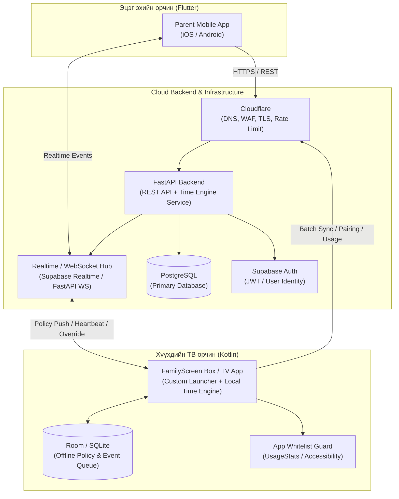
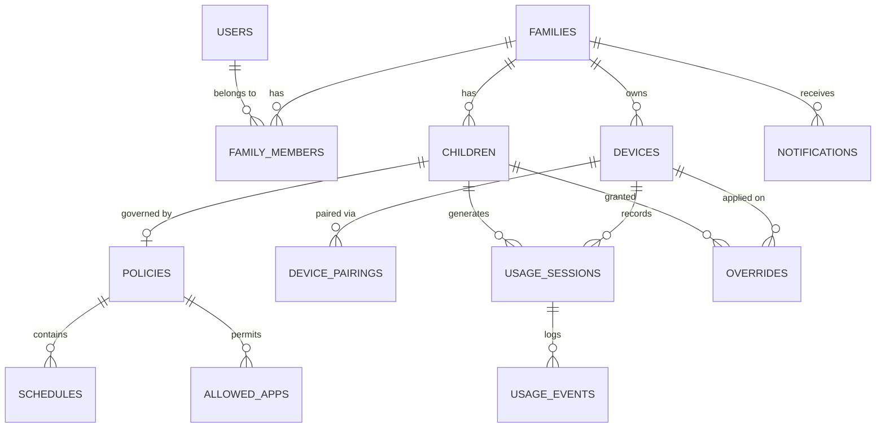

# FAMILYSCREEN — 02. System Architecture, Database & API Specification

| Талбар | Утга |
|---|---|
| **Баримт бичиг** | 02-р үе шат: Системийн Архитектур, Өгөгдлийн сан ба API |
| **Хувилбар** | 1.0 |
| **Төлөв** | Баталгаажсан суурь загвар |
| **Технологийн стек** | FastAPI, PostgreSQL, Supabase (Auth/Realtime), Flutter, Kotlin (Android TV/Box) |

---

# 1. Системийн ерөнхий архитектур (High-Level Architecture)

FamilyScreen нь **Cloud-coordinated, Edge-enforced (Серверээс удирдаж, төхөөрөмж дээр шууд хэрэгжүүлдэг)** архитектуртай. Энэ нь интернэт тасарсан ч TV Box / TV App өөрийн локал Time Engine болон кэшлэгдсэн Policy-ийн дагуу хүүхдийн хугацааг 100% найдвартай хянаж, блоклох боломжийг хангана.



## 1.1. Бүрэлдэхүүн хэсгүүдийн үүрэг

1. **Parent Mobile App (Flutter):**
   - Эцэг эхийн бүртгэл, гэр бүл үүсгэх, хүүхдийн профайл удирдах.
   - QR эсвэл 6 оронтой кодоор TV/Box холбох.
   - Өдрийн лимит, цагийн хуваарь, зөвшөөрөгдсөн апп (Whitelist), PIN код тохируулах.
   - Алсаас шууд нэмэлт хугацаа өгөх (`Remote Override`) эсвэл шууд түгжих (`Instant Lock`).
   - Өдөр, 7 хоног, сарын хэрэглээний график тайлан харах.

2. **FastAPI Cloud Backend:**
   - **Domain-Driven Clean Architecture:** Auth, Family, Child, Device, Policy, TimeEngine, Usage, Override, Notification модулиуд.
   - **Authoritative Time & Sync:** Серверийн цагаар (`UTC` + гэр бүлийн `timezone`, анхдагчаар `Asia/Ulaanbaatar`) өдрийн лимит, хуваарь, нэмэлт хугацааг нэгтгэн `PolicySnapshot` бэлтгэж төхөөрөмжид илгээх.
   - **Idempotent Usage Ingestion:** Төхөөрөмжөөс ирэх онлайн болон оффлайн хэрэглээний багцуудыг давхардалгүй (`client_event_id` / `session_id`) хүлээн авч нэгтгэх.

3. **FamilyScreen Box & Android TV App (Kotlin):**
   - **Local Time Engine:** 1 секунд тутмын monotonic clock (`SystemClock.elapsedRealtime()`) ашиглан системийн цаг ухраах/өөрчлөх мэхлэлтээс хамгаалсан тоолуур ажиллуулах.
   - **FamilyScreen Launcher (Box):** Зөвхөн `allowed_apps` жагсаалтад багтсан аппуудыг дэлгэцэнд харуулах, зөвшөөрөлгүй апп руу шилжихэд блок дэлгэц (`Blocking Overlay`) гаргах.
   - **Offline-First Persistence:** Хамгийн сүүлд серверээс татсан `PolicySnapshot` болон `PIN hash`-ийг локал санах ойд хадгалж, интернэтгүй үед ч `ALLOW -> WARNING -> BLOCK` болон локал PIN Override-ийг ажиллуулах.

---

# 2. Өгөгдлийн сангийн дизайн (PostgreSQL Schema)

## 2.1. Entity-Relationship Diagram (ERD)



## 2.2. Хүснэгтүүдийн нарийвчилсан бүтэц (13 үндсэн хүснэгт)

### 1. `users` — Эцэг эхийн хэрэглэгчийн бүртгэл
| Багана | Төрөл | Хязгаарлалт | Тайлбар |
|---|---|---|---|
| `id` | `UUID` | `PK` | Хэрэглэгчийн ID (Supabase Auth `sub`-тай ижил байж болно) |
| `email` | `VARCHAR(255)` | `UNIQUE, NOT NULL` | Имэйл хаяг |
| `phone` | `VARCHAR(32)` | `UNIQUE, NULL` | Утасны дугаар |
| `password_hash` | `VARCHAR(255)` | `NOT NULL` | Bcrypt / Argon2 нууц үгийн хэш |
| `full_name` | `VARCHAR(120)` | `NOT NULL` | Эцэг эхийн нэр |
| `is_active` | `BOOLEAN` | `DEFAULT TRUE` | Идэвхтэй эсэх |
| `created_at` | `TIMESTAMPTZ` | `NOT NULL DEFAULT NOW()` | Үүссэн огноо |
| `updated_at` | `TIMESTAMPTZ` | `NOT NULL DEFAULT NOW()` | Шинэчилсэн огноо |

### 2. `families` — Гэр бүлийн нэгж
| Багана | Төрөл | Хязгаарлалт | Тайлбар |
|---|---|---|---|
| `id` | `UUID` | `PK` | Гэр бүлийн ID |
| `name` | `VARCHAR(120)` | `NOT NULL` | Гэр бүлийн нэр (жнь: "Бат-Эрдэнийн гэр бүл") |
| `timezone` | `VARCHAR(64)` | `NOT NULL DEFAULT 'Asia/Ulaanbaatar'` | Цагийн бүс |
| `plan_tier` | `VARCHAR(20)` | `NOT NULL DEFAULT 'FREE'` | `FREE` эсвэл `PREMIUM` |
| `pin_hash` | `VARCHAR(255)` | `NULL` | Эцэг эхийн 4–6 оронтой PIN кодын хэш (хэзээ ч plain text хадгалахгүй) |
| `pin_failed_attempts` | `INT` | `NOT NULL DEFAULT 0` | PIN буруу оруулсан тоо (Rate limit) |
| `pin_locked_until` | `TIMESTAMPTZ` | `NULL` | PIN түр түгжигдсэн хугацаа |
| `created_at` | `TIMESTAMPTZ` | `NOT NULL DEFAULT NOW()` | Үүссэн огноо |

### 3. `family_members` — Гэр бүлийн эцэг эхчүүдийн эрх
| Багана | Төрөл | Хязгаарлалт | Тайлбар |
|---|---|---|---|
| `id` | `UUID` | `PK` | Бичлэгийн ID |
| `family_id` | `UUID` | `FK -> families.id ON DELETE CASCADE` | Гэр бүлийн ID |
| `user_id` | `UUID` | `FK -> users.id ON DELETE CASCADE` | Хэрэглэгчийн ID |
| `role` | `VARCHAR(20)` | `NOT NULL DEFAULT 'OWNER'` | `OWNER`, `PARENT`, `CAREGIVER` |
| `created_at` | `TIMESTAMPTZ` | `NOT NULL DEFAULT NOW()` | Нэгдсэн огноо |
| *Constraint* | `UNIQUE(family_id, user_id)` | | Нэг хэрэглэгч нэг гэр бүлд давхардахгүй |

### 4. `children` — Хүүхдийн профайл (Data Minimization зарчимтай)
| Багана | Төрөл | Хязгаарлалт | Тайлбар |
|---|---|---|---|
| `id` | `UUID` | `PK` | Хүүхдийн ID |
| `family_id` | `UUID` | `FK -> families.id ON DELETE CASCADE` | Гэр бүлийн ID |
| `nickname` | `VARCHAR(80)` | `NOT NULL` | Хүүхдийн нэр эсвэл хоч (Бодит овог нэр, РД шаардахгүй) |
| `age_group` | `VARCHAR(20)` | `NOT NULL` | `4-6`, `7-9`, `10-12`, `13-16` |
| `avatar_key` | `VARCHAR(64)` | `NOT NULL DEFAULT 'fox'` | Урьдчилан бэлдсэн дүрсний түлхүүр |
| `is_active` | `BOOLEAN` | `DEFAULT TRUE` | Идэвхтэй эсэх |
| `created_at` | `TIMESTAMPTZ` | `NOT NULL DEFAULT NOW()` | Үүссэн огноо |

### 5. `devices` — TV болон FamilyScreen Box төхөөрөмжүүд
| Багана | Төрөл | Хязгаарлалт | Тайлбар |
|---|---|---|---|
| `id` | `UUID` | `PK` | Төхөөрөмжийн ID |
| `family_id` | `UUID` | `FK -> families.id ON DELETE CASCADE, NULL` | Холбогдсон гэр бүл |
| `active_child_id` | `UUID` | `FK -> children.id ON DELETE SET NULL, NULL` | Одоо үзэж буй хүүхдийн профайл |
| `device_name` | `VARCHAR(120)` | `NOT NULL` | Төхөөрөмжийн нэр (жнь: "Зочны өрөөний ТВ") |
| `device_type` | `VARCHAR(30)` | `NOT NULL` | `ANDROID_TV`, `FAMILYSCREEN_BOX`, `TIZEN`, `WEBOS` |
| `hardware_uid` | `VARCHAR(128)` | `UNIQUE, NOT NULL` | Төхөөрөмжийн давтагдашгүй таних код |
| `device_token_hash` | `VARCHAR(255)` | `NULL` | Төхөөрөмжийн API хандалтын токены хэш |
| `app_version` | `VARCHAR(32)` | `NOT NULL DEFAULT '1.0.0'` | Аппын хувилбар |
| `status` | `VARCHAR(20)` | `NOT NULL DEFAULT 'OFFLINE'` | `ONLINE`, `OFFLINE`, `UNPAIRED` |
| `last_seen_at` | `TIMESTAMPTZ` | `NULL` | Сүүлд сервертэй холбогдсон цаг |
| `created_at` | `TIMESTAMPTZ` | `NOT NULL DEFAULT NOW()` | Бүртгэгдсэн огноо |

### 6. `device_pairings` — QR / Богино кодоор холбох хүсэлт
| Багана | Төрөл | Хязгаарлалт | Тайлбар |
|---|---|---|---|
| `id` | `UUID` | `PK` | Холболтын ID |
| `device_id` | `UUID` | `FK -> devices.id ON DELETE CASCADE` | Төхөөрөмжийн ID |
| `pairing_code` | `VARCHAR(8)` | `UNIQUE, NOT NULL` | 6 оронтой код (жнь: `482910`) |
| `qr_payload` | `TEXT` | `NOT NULL` | QR кодонд орох JSON/URI утга |
| `status` | `VARCHAR(20)` | `NOT NULL DEFAULT 'PENDING'` | `PENDING`, `CLAIMED`, `EXPIRED` |
| `claimed_by_family_id` | `UUID` | `FK -> families.id ON DELETE SET NULL, NULL` | Холбож авсан гэр бүл |
| `expires_at` | `TIMESTAMPTZ` | `NOT NULL` | Дуусах хугацаа (10 минут) |
| `created_at` | `TIMESTAMPTZ` | `NOT NULL DEFAULT NOW()` | Үүссэн огноо |

### 7. `policies` — Хүүхдийн хугацааны болон анхааруулгын үндсэн дүрэм
| Багана | Төрөл | Хязгаарлалт | Тайлбар |
|---|---|---|---|
| `id` | `UUID` | `PK` | Дүрмийн ID |
| `family_id` | `UUID` | `FK -> families.id ON DELETE CASCADE` | Гэр бүлийн ID |
| `child_id` | `UUID` | `UNIQUE, FK -> children.id ON DELETE CASCADE` | Хүүхдийн ID |
| `daily_limit_minutes` | `INT` | `NOT NULL DEFAULT 90 CHECK (daily_limit_minutes BETWEEN 0 AND 720)` | Өдрийн үндсэн лимит (минутаар) |
| `weekend_bonus_minutes` | `INT` | `NOT NULL DEFAULT 0 CHECK (weekend_bonus_minutes BETWEEN 0 AND 360)` | Амралтын өдрийн нэмэлт минут |
| `warning_minutes_csv` | `VARCHAR(64)` | `NOT NULL DEFAULT '15,5,1'` | Анхааруулга өгөх үлдэгдэл минутууд |
| `enforce_whitelist` | `BOOLEAN` | `NOT NULL DEFAULT TRUE` | Зөвшөөрөгдсөн аппын хязгаарлалт идэвхтэй эсэх |
| `is_instant_locked` | `BOOLEAN` | `NOT NULL DEFAULT FALSE` | Эцэг эх шууд түгжсэн эсэх |
| `version` | `INT` | `NOT NULL DEFAULT 1` | Дүрмийн хувилбар (Төхөөрөмж синхрончлоход ашиглана) |
| `updated_at` | `TIMESTAMPTZ` | `NOT NULL DEFAULT NOW()` | Сүүлд өөрчилсөн огноо |

### 8. `schedules` — Долоо хоногийн үзэх цагийн хуваарь
| Багана | Төрөл | Хязгаарлалт | Тайлбар |
|---|---|---|---|
| `id` | `UUID` | `PK` | Хуваарийн ID |
| `policy_id` | `UUID` | `FK -> policies.id ON DELETE CASCADE` | Дүрмийн ID |
| `day_of_week` | `SMALLINT` | `NOT NULL CHECK (day_of_week BETWEEN 0 AND 6)` | `0=Даваа ... 6=Ням` |
| `is_school_day` | `BOOLEAN` | `NOT NULL DEFAULT TRUE` | Хичээлтэй өдөр эсэх |
| `start_time` | `TIME` | `NOT NULL` | Үзэж эхлэх боломжтой цаг (жнь: `14:00`) |
| `end_time` | `TIME` | `NOT NULL` | Үзэж дуусах цаг (жнь: `20:30`) |
| `is_enabled` | `BOOLEAN` | `NOT NULL DEFAULT TRUE` | Энэ өдөр үзэхийг зөвшөөрсөн эсэх |

### 9. `allowed_apps` — Зөвшөөрөгдсөн аппуудын жагсаалт (Whitelist)
| Багана | Төрөл | Хязгаарлалт | Тайлбар |
|---|---|---|---|
| `id` | `UUID` | `PK` | Бичлэгийн ID |
| `policy_id` | `UUID` | `FK -> policies.id ON DELETE CASCADE` | Дүрмийн ID |
| `package_name` | `VARCHAR(255)` | `NOT NULL` | Android package name (жнь: `com.google.android.apps.youtube.kids`) |
| `app_label` | `VARCHAR(120)` | `NOT NULL` | Аппын харагдах нэр (жнь: `YouTube Kids`) |
| `category` | `VARCHAR(40)` | `NOT NULL DEFAULT 'EDUCATION'` | `EDUCATION`, `VIDEO`, `GAME`, `OTHER` |
| `is_allowed` | `BOOLEAN` | `NOT NULL DEFAULT TRUE` | Зөвшөөрсөн эсэх |
| *Constraint* | `UNIQUE(policy_id, package_name)` | | Нэг дүрэмд нэг апп давхардахгүй |

### 10. `usage_sessions` — Бодит үзсэн хугацааны сесс
| Багана | Төрөл | Хязгаарлалт | Тайлбар |
|---|---|---|---|
| `id` | `UUID` | `PK` | Сессийн ID |
| `client_session_uid` | `VARCHAR(128)` | `UNIQUE, NOT NULL` | Төхөөрөмж дээр үүссэн UUID (Idempotency / Offline sync) |
| `family_id` | `UUID` | `FK -> families.id ON DELETE CASCADE` | Гэр бүлийн ID |
| `child_id` | `UUID` | `FK -> children.id ON DELETE CASCADE` | Хүүхдийн ID |
| `device_id` | `UUID` | `FK -> devices.id ON DELETE CASCADE` | Төхөөрөмжийн ID |
| `package_name` | `VARCHAR(255)` | `NOT NULL` | Ашигласан аппын package name |
| `usage_date` | `DATE` | `NOT NULL` | Гэр бүлийн timezone дахь огноо (`YYYY-MM-DD`) |
| `started_at` | `TIMESTAMPTZ` | `NOT NULL` | Эхэлсэн цаг |
| `ended_at` | `TIMESTAMPTZ` | `NULL` | Дууссан цаг |
| `active_seconds` | `INT` | `NOT NULL DEFAULT 0 CHECK (active_seconds >= 0)` | Түр зогсолтыг хассан цэвэр идэвхтэй секунд |
| `synced_from_offline` | `BOOLEAN` | `NOT NULL DEFAULT FALSE` | Интернэтгүй байж байгаад нөхөж орсон эсэх |
| `created_at` | `TIMESTAMPTZ` | `NOT NULL DEFAULT NOW()` | Серверт бүртгэгдсэн цаг |

### 11. `usage_events` — Сесс доторх нарийвчилсан төлөвийн лог
| Багана | Төрөл | Хязгаарлалт | Тайлбар |
|---|---|---|---|
| `id` | `UUID` | `PK` | Эвентийн ID |
| `session_id` | `UUID` | `FK -> usage_sessions.id ON DELETE CASCADE` | Сессийн ID |
| `event_type` | `VARCHAR(30)` | `NOT NULL` | `START`, `PAUSE`, `RESUME`, `WARNING_15`, `WARNING_5`, `WARNING_1`, `BLOCKED` |
| `occurred_at` | `TIMESTAMPTZ` | `NOT NULL` | Эвент болсон цаг |
| `metadata_json` | `JSONB` | `NULL` | Нэмэлт мэдээлэл |

### 12. `overrides` — PIN эсвэл Алсаас нэмэлт хугацаа өгсөн түүх
| Багана | Төрөл | Хязгаарлалт | Тайлбар |
|---|---|---|---|
| `id` | `UUID` | `PK` | Override ID |
| `family_id` | `UUID` | `FK -> families.id ON DELETE CASCADE` | Гэр бүлийн ID |
| `child_id` | `UUID` | `FK -> children.id ON DELETE CASCADE` | Хүүхдийн ID |
| `device_id` | `UUID` | `FK -> devices.id ON DELETE SET NULL, NULL` | Төхөөрөмжийн ID |
| `granted_by_user_id` | `UUID` | `FK -> users.id ON DELETE SET NULL, NULL` | Зөвшөөрсөн эцэг эх |
| `source` | `VARCHAR(20)` | `NOT NULL` | `TV_PIN` (ТВ дээр PIN хийсэн) эсвэл `REMOTE_APP` (Утаснаас өгсөн) |
| `added_minutes` | `INT` | `NOT NULL CHECK (added_minutes IN (5, 10, 15, 30, 60))` | Нэмсэн минут |
| `override_date` | `DATE` | `NOT NULL` | Хүчинтэй өдөр (`YYYY-MM-DD`) |
| `reason` | `VARCHAR(255)` | `NULL` | Тайлбар (жнь: "Гэрийн даалгавраа дуусгасан") |
| `created_at` | `TIMESTAMPTZ` | `NOT NULL DEFAULT NOW()` | Өгсөн цаг |

### 13. `notifications` — Эцэг эхэд очих мэдэгдлүүд
| Багана | Төрөл | Хязгаарлалт | Тайлбар |
|---|---|---|---|
| `id` | `UUID` | `PK` | Мэдэгдлийн ID |
| `family_id` | `UUID` | `FK -> families.id ON DELETE CASCADE` | Гэр бүлийн ID |
| `type` | `VARCHAR(40)` | `NOT NULL` | `TIME_EXPIRED`, `DEVICE_OFFLINE`, `POLICY_UPDATED`, `OVERRIDE_USED`, `TIME_REQUESTED` |
| `title` | `VARCHAR(160)` | `NOT NULL` | Гарчиг (Монгол хэлээр) |
| `body` | `TEXT` | `NOT NULL` | Дэлгэрэнгүй мэдээлэл |
| `is_read` | `BOOLEAN` | `NOT NULL DEFAULT FALSE` | Уншсан эсэх |
| `created_at` | `TIMESTAMPTZ` | `NOT NULL DEFAULT NOW()` | Үүссэн цаг |

### 2.3. Индексжүүлэлт (Indexes for High Performance)
- `idx_usage_sessions_child_date` ON `usage_sessions(child_id, usage_date)` — Өдрийн болон 7 хоногийн тайлан, үлдэгдэл хугацааг $O(\log N)$ хурдаар бодоход.
- `idx_overrides_child_date` ON `overrides(child_id, override_date)` — Тухайн өдрийн нэмэлт минутыг хурдан нийлбэрлэхэд.
- `idx_device_pairings_code` ON `device_pairings(pairing_code)` WHERE `status = 'PENDING'` — Partial index.
- `idx_notifications_family_unread` ON `notifications(family_id, created_at DESC)` WHERE `is_read = FALSE`.

---

# 3. Time Engine — Нарийвчилсан Алгоритм ба Логик

Time Engine нь **Server-side (FastAPI)** болон **Client-side (Kotlin TV/Box)** дээр ижил детерминистик дүрмээр ажиллана.

## 3.1. Нийт боломжит хугацаа ба Үлдэгдэл тооцоолол

Тухайн өдрийн ($d$) хүүхдийн ($c$) нийт зөвшөөрөгдсөн хугацаа ($T_{\text{allowed}}$):

$$T_{\text{allowed}}(c, d) = L_{\text{daily}}(c) + B_{\text{weekend}}(c, d) + \sum_{k} O_{k}(c, d)$$

Үүнд:
- $L_{\text{daily}}(c)$ — Өдрийн үндсэн лимит (`daily_limit_minutes` $\times 60$ секунд).
- $B_{\text{weekend}}(c, d)$ — Амралтын өдөр (Бямба, Ням) бол `weekend_bonus_minutes` $\times 60$ секунд.
- $\sum O_{k}(c, d)$ — Тухайн өдөр PIN-ээр болон алсаас өгсөн бүх `overrides.added_minutes` $\times 60$ секунд.

Тухайн өдрийн нийт ашигласан идэвхтэй хугацаа ($T_{\text{used}}$):

$$T_{\text{used}}(c, d) = \sum_{s} \text{active\_seconds}_{s}(c, d)$$

Үлдэгдэл хугацаа ($T_{\text{remaining}}$):

$$T_{\text{remaining}}(c, d) = \max\left(0, T_{\text{allowed}}(c, d) - T_{\text{used}}(c, d)\right)$$

## 3.2. Төлөвийн машин (State Machine Decision Table)

Шалгалтын дараалал (Priority Order):

1. **Instant Lock шалгах:** Хэрэв `policy.is_instant_locked == true` бол:
   - Төлөв: `BLOCK` (`reason = "PARENT_INSTANT_LOCK"`).
2. **Schedule Window шалгах:** Одоогийн локал цаг (`now_local`) тухайн гарагийн `schedules` цонхонд багтаагүй эсвэл `is_enabled == false` бол:
   - Төлөв: `BLOCK` (`reason = "OUTSIDE_SCHEDULE_WINDOW"`).
3. **Daily Quota шалгах:** Хэрэв $T_{\text{remaining}} \le 0$ бол:
   - Төлөв: `BLOCK` (`reason = "DAILY_LIMIT_REACHED"`).
4. **Warning босго шалгах:**
   - Цагийн хуваарь дуусахад үлдсэн хугацаа $T_{\text{window\_left}} = \text{end\_time} - \text{now\_local}$.
   - Бодит үлдсэн хугацаа $T_{\text{effective}} = \min(T_{\text{remaining}}, T_{\text{window\_left}})$.
   - Хэрэв $T_{\text{effective}} \le \max(\text{warning\_thresholds})$ (жишээ нь $\le 15$ минут буюу 900 секунд) бол:
     - Төлөв: `WARNING` (`active_warning_threshold = 15 | 5 | 1`).
5. **Бусад тохиолдолд:**
   - Төлөв: `ALLOW`.

---

# 4. REST API Specification (v1)

Бүх API зам `/api/v1` угтвартай байна. Алдааны хариу нь **RFC 7807 Problem Details** стандартыг баримтална:
```json
{
  "type": "https://api.familyscreen.mn/errors/pin-locked",
  "title": "PIN код түр түгжигдсэн байна",
  "status": 429,
  "detail": "PIN кодыг 5 удаа буруу оруулсан тул 15 минутын дараа дахин оролдоно уу.",
  "instance": "/api/v1/overrides"
}
```

## 4.1. Authentication & Family (`/auth`, `/families`)

### `POST /api/v1/auth/register`
Эцэг эх шинээр бүртгүүлж, анхны гэр бүлийн бүртгэл үүсгэх.
- **Request:**
```json
{
  "email": "mother@example.mn",
  "phone": "+97699112233",
  "password": "StrongPassword123!",
  "full_name": "Сарангэрэл",
  "family_name": "Сарангэрэлийн гэр бүл",
  "pin_code": "2580"
}
```
- **Response (`201 Created`):**
```json
{
  "access_token": "eyJhbGciOiJIUzI1NiIs...",
  "token_type": "bearer",
  "user": {
    "id": "u-uuid",
    "email": "mother@example.mn",
    "full_name": "Сарангэрэл"
  },
  "family": {
    "id": "f-uuid",
    "name": "Сарангэрэлийн гэр бүл",
    "timezone": "Asia/Ulaanbaatar",
    "plan_tier": "FREE"
  }
}
```

### `POST /api/v1/auth/login`
- **Request:** `{"email": "mother@example.mn", "password": "StrongPassword123!"}`
- **Response (`200 OK`):** JWT Token + User & Family мэдээлэл.

---

## 4.2. Children & Policies (`/children`, `/policies`)

### `POST /api/v1/children`
Хүүхдийн профайл үүсгэх (автоматаар анхдагч 90 минутын Policy + Default Whitelist үүснэ).
- **Request:**
```json
{
  "family_id": "f-uuid",
  "nickname": "Тэмүүлэн",
  "age_group": "7-9",
  "avatar_key": "astronaut",
  "daily_limit_minutes": 90
}
```
- **Response (`201 Created`):** Хүүхдийн мэдээлэл болон анхдагч `policy_id`.

### `PUT /api/v1/policies/{child_id}`
Хүүхдийн өдрийн лимит, цагийн хуваарь, анхааруулга болон зөвшөөрөгдсөн аппуудыг шинэчлэх.
- **Request:**
```json
{
  "daily_limit_minutes": 90,
  "weekend_bonus_minutes": 30,
  "warning_minutes": [15, 5, 1],
  "enforce_whitelist": true,
  "is_instant_locked": false,
  "schedules": [
    {"day_of_week": 0, "is_school_day": true, "start_time": "15:00", "end_time": "20:00", "is_enabled": true},
    {"day_of_week": 5, "is_school_day": false, "start_time": "10:00", "end_time": "21:00", "is_enabled": true}
  ],
  "allowed_apps": [
    {"package_name": "com.google.android.apps.youtube.kids", "app_label": "YouTube Kids", "category": "VIDEO", "is_allowed": true},
    {"package_name": "org.khanacademy.android", "app_label": "Khan Academy", "category": "EDUCATION", "is_allowed": true}
  ]
}
```

---

## 4.3. Device Pairing & Sync (`/devices`)

### `POST /api/v1/devices/pair/init` (TV / Box дуудна)
Төхөөрөмж анх асах үед 6 оронтой код болон QR үүсгэх.
- **Request:**
```json
{
  "hardware_uid": "vbox-android-982341a",
  "device_type": "FAMILYSCREEN_BOX",
  "device_name": "Android TV Box",
  "app_version": "1.0.0"
}
```
- **Response (`201 Created`):**
```json
{
  "device_id": "d-uuid",
  "pairing_code": "482910",
  "qr_payload": "familyscreen://pair?code=482910&device_id=d-uuid",
  "expires_at": "2026-11-08T23:00:00+08:00"
}
```

### `POST /api/v1/devices/pair/claim` (Parent Mobile App дуудна)
Эцэг эх гар утаснаасаа 6 оронтой кодыг оруулж гэр бүлдээ болон хүүхдэдээ холбох.
- **Request:**
```json
{
  "family_id": "f-uuid",
  "pairing_code": "482910",
  "device_name": "Зочны өрөөний Box",
  "active_child_id": "c-uuid"
}
```
- **Response (`200 OK`):** Холбогдсон төхөөрөмжийн мэдээлэл.

### `GET /api/v1/devices/{device_id}/sync` (TV / Box дуудна)
Төхөөрөмж серверээс хамгийн сүүлийн дүрэм, Time Engine-ийн төлөв, үлдэгдэл хугацааг татах.
- **Response (`200 OK`):**
```json
{
  "server_time_utc": "2026-11-08T14:50:00Z",
  "family_timezone": "Asia/Ulaanbaatar",
  "device_id": "d-uuid",
  "active_child_id": "c-uuid",
  "child_nickname": "Тэмүүлэн",
  "policy_version": 4,
  "time_state": {
    "state": "ALLOW",
    "reason": "WITHIN_LIMIT_AND_SCHEDULE",
    "allowed_seconds_today": 5400,
    "used_seconds_today": 1800,
    "remaining_seconds_today": 3600,
    "effective_remaining_seconds": 3600,
    "next_warning_at_remaining_seconds": 900,
    "active_warning_minutes": null
  },
  "allowed_apps": [
    {"package_name": "com.google.android.apps.youtube.kids", "app_label": "YouTube Kids", "category": "VIDEO"}
  ]
}
```

---

## 4.4. Usage Sessions, Overrides & Reports (`/usage`, `/overrides`, `/reports`)

### `POST /api/v1/usage/sessions`
Төхөөрөмжөөс идэвхтэй хэрэглээний сессийг (онлайн эсвэл оффлайн багцаар) илгээх.
- **Request:**
```json
{
  "client_session_uid": "sess-local-99812",
  "family_id": "f-uuid",
  "child_id": "c-uuid",
  "device_id": "d-uuid",
  "package_name": "com.google.android.apps.youtube.kids",
  "started_at": "2026-11-08T09:00:00Z",
  "ended_at": "2026-11-08T09:15:00Z",
  "active_seconds": 900,
  "synced_from_offline": false
}
```
- **Response (`200 OK`):** Шинэчлэгдсэн `time_state` буцаана.

### `POST /api/v1/overrides`
PIN кодоор (TV дээр) эсвэл гар утаснаас нэмэлт хугацаа өгөх.
- **Request:**
```json
{
  "family_id": "f-uuid",
  "child_id": "c-uuid",
  "device_id": "d-uuid",
  "source": "TV_PIN",
  "pin_code": "2580",
  "added_minutes": 15,
  "reason": "Нэмэлт 15 минут зөвшөөрөв"
}
```
- **Response (`201 Created`):** Нэмэгдсэн минут болон шинэ `time_state`.

### `GET /api/v1/reports/summary?family_id={f-uuid}&child_id={c-uuid}&days=7`
Өдрийн болон 7 хоногийн хэрэглээний тайлан авах.
- **Response (`200 OK`):** Өдөр бүрийн зөвшөөрсөн хугацаа, бодит үзсэн хугацаа, апп тус бүрийн задаргаа.
