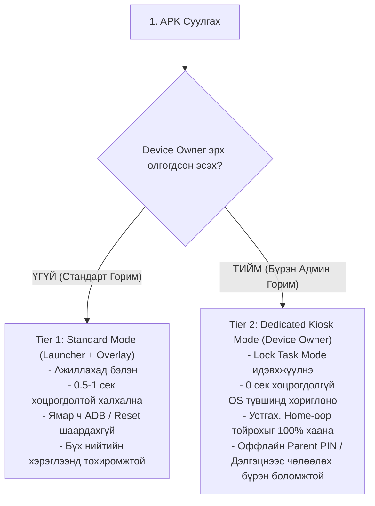

# FamilyScreen — Phase 10.3: Android Device Owner & Kiosk Mode Feasibility Report

**Огноо:** 2026-11-10  
**Аудит хийсэн:** Principal Systems, Android TV & Security Architect  
**Төлөв:** Техникийн судалгаа ба Архитектурын харьцуулалт бүрэн хийгдсэн (Feasibility & Comparative Study Complete - Corrected for API Precision)  
**Репозитор:** `https://github.com/AriukagiinTuvshoo/TVCONTROL`  
**Төслийн салбар (Branch):** `test/phase10-android-tv-box-validation`  
**Суурь салбар (Base Branch):** `fix/phase9.2-migration-safety` (Commit `77ee553`)  
**Кодын commit SHA:** `c9cdcbb`  
**Main салбарын төлөв:** `951a5dc` (Main салбар огт өөрчлөгдөөгүй, PR нээгээгүй, Phase 11 эхлээгүй)

---

## 1. Асуудлын Тодорхойлолт ба Зорилго (Problem Statement & Objective)

FamilyScreen төслийн одоогийн Android TV Box аппликейшн нь ердийн гуравдагч (third-party) апп хэлбэрээр ажилладаг. Гэвч хүүхдийн дэлгэцийн цаг болон апп хэрэглээг найдвартай хязгаарлах бодит орчинд дараах хоёр суурь дутагдал ажиглагддаг:

1. **Халхлах хугацааны саатал (0.5 – 1.0 секунд):**  
   Зөвшөөрөгдөөгүй апп (эсвэл BLOCK төлөвт орсон үед YouTube/Netflix) нээгдэх үед `UsageMonitoringService` нь 1 секундын давтамжтай шалгаж, FamilyScreen Launcher-ийг урд талд дууддаг (Overlay Takeover). Апп аль хэдийн нээгдсэний дараа мэддэг тул 0.5–1 секундын турш хориглосон контентыг харах, дахин дахин дарж саатуулах боломжтой.
2. **Системийн түвшинд тойрох эрсдэл (Bypass Risks):**  
   Энгийн апп нь физик удирдлагын Home товчлуурыг системийн түвшинд бүрэн шүүх, бусад аппыг OS түвшинд шууд хаах (`forceStopPackage`), эсвэл өөрийгөө устгуулахаас (`DISALLOW_UNINSTALL_APPS`) бүрэн сэргийлэх эрхгүй байдаг.

**Энэхүү шинжилгээний зорилго:**  
FamilyScreen-ийг Android-ийн **Device Owner (Dedicated Device / Kiosk Mode)** горимд шилжүүлэх боломж, түүний давуу болон сул талууд, учирч болох техник хангамжийн эрсдэлүүд, аюулгүй байдлын онцгой дүрмүүдийг (эзэмшигчийн зөвшөөрөлгүй түгжихгүй байх зарчим) нарийвчлан судалж, эцсийн архитектурын шийдлийг гаргах.

---

## 2. Одоогийн Архитектурын Аудит (Architecture A Audit)

### 2.1. Бүрэлдэхүүн хэсгүүдийн үүрэг:
- [`AndroidManifest.xml`](file:///c:/Users/enhtv/Documents/tv%20control/android_tv_box/app/src/main/AndroidManifest.xml):
  `FamilyScreenLauncherActivity`-д `CATEGORY_HOME`, `CATEGORY_DEFAULT`, `CATEGORY_LEANBACK_LAUNCHER` зарлаж, Android TV-ийн Custom Home Launcher болж ажилладаг.
- [`UsageMonitoringService`](file:///c:/Users/enhtv/Documents/tv%20control/android_tv_box/app/src/main/java/mn/familyscreen/tv/service/UsageMonitoringService.kt):
  Android 14 (API 34)-ийн Foreground Service (`specialUse`) хэлбэрээр ажиллаж, 1000ms тутамд `UsageStatsManager.queryUsageStats()`-аар foreground package-ийг хянадаг. Хориглогдсон апп нээгдвэл `FLAG_ACTIVITY_NEW_TASK or FLAG_ACTIVITY_CLEAR_TOP` тугтайгаар Launcher-ийг дууддаг.
- [`BootPolicyRestoreReceiver`](file:///c:/Users/enhtv/Documents/tv%20control/android_tv_box/app/src/main/java/mn/familyscreen/tv/service/BootPolicyRestoreReceiver.kt):
  Төхөөрөмж асахад `BOOT_COMPLETED` эвентээр хяналтын сервисийг ажиллуулдаг.
- **Шаардагдах эрхүүд:** `PACKAGE_USAGE_STATS` (хэрэглээг хянах), `SYSTEM_ALERT_WINDOW` (дэлгэц дээр халхлах).

### 2.2. Хязгаарлалт ба Сул талууд:
- **Татгалзах (Proactive Block) хийж чаддаггүй:** Апп аль хэдийн нээгдсэний *дараа* (Reactive) л мэдээд буцааж дууддаг тул 0.5–1 секундын саатал гардаг.
- **Home товчны сул тал:** Хэрэв хэрэглэгч FamilyScreen-ийг үндсэн Launcher-аар "Always" гэж сонгоогүй эсвэл ТВ үйлдвэрлэгчийн систем Home товчийг өөрийн Store/Launcher луу хүчилдэг бол хүүхэд Home дараад 1 секундын хугацаанд системийн цэс рүү үсэрч болно.
- **Устгах эрсдэл:** Хэрэглэгч Android Settings рүү орж FamilyScreen аппыг гараар устгах (`Uninstall`) боломжтой.

---

## 3. Device Owner & Kiosk Mode Техникийн Боломж (Architecture B)

Android 5.0 (API 21)+ Enterprise платформоос эхлэн нэвтэрсэн **Device Owner** нь тухайн төхөөрөмжийг бүхэлд нь удирдах эрхтэй цорын ганц администратор апп болдог.

### 3.1. Device Owner-ийн гол чадамжууд ба API Нарийвчлал:
1. **Төгс Түгжээ буюу Lock Task Mode (Kiosk Mode):**
   - API: `dpm.setLockTaskPackages(adminComponent, arrayOf(packageName, "com.google.android.apps.youtube.kids"))`
   - Ажиллуулах: `activity.startLockTask()`
   - **Үр дүн:** Системийн түвшинд зөвхөн зөвшөөрөгдсөн аппууд л Lock Task-д орох эсвэл зэрэгцэн ажиллах эрхтэй болно. Зөвшөөрөгдөөгүй аппыг нээх гэж оролдоход Android OS түүнийг огт асаахгүй (Zero-latency / 0 секундын сааталгүйгээр шууд татгалзана).
   - **Анхаарах зүйл:** `setLockTaskPackages()` нь аппуудыг хооронд нь автоматаар шилжүүлж нээхгүй. Апп хооронд шилжихэд стандарт Intent (`FLAG_ACTIVITY_NEW_TASK`) зохицуулалт хийгдэх шаардлагатай. Мөн whitelist-ийн апп дотроос дуудагддаг дэд сангууд (Google Play Services, WebView) багцын жагсаалтад нийцсэн байх ёстой.
2. **Байнгын Home Launcher болгох (Persistent Preferred Activity):**
   - API: `dpm.addPersistentPreferredActivity(adminComponent, filter, activityComponent)`
   - **Үр дүн:** Хэрэглэгчээс ямар нэгэн сонголт асуухгүйгээр FamilyScreen нь төхөөрөмжийн байнгын, өөрчлөх боломжгүй үндсэн дэлгэц болно.
3. **Хэрэглэгчийн үйлдлийг хязгаарлах (User Restrictions):**
   - `UserManager.DISALLOW_UNINSTALL_APPS`: FamilyScreen-ийг тохиргооноос устгах боломжийг хаана.
   - `UserManager.DISALLOW_SAFE_BOOT`: Төхөөрөмжийг Safe Mode-оор асааж хамгаалалтыг тойрохоос сэргийлнэ.
   - `UserManager.DISALLOW_FACTORY_RESET`: Тохиргооны цэснээс төхөөрөмжийг reset хийхийг хаана (гэхдээ физик товчлуурын recovery reset хэвээр үлдэнэ).
   - `UserManager.DISALLOW_MODIFY_ACCOUNTS`: Системийн данс нэмэх/хасахыг хязгаарлана.

### 3.2. Device Owner Суулгах ба Provisioning Шаардлага:
Device Owner болохын тулд Android үйлдлийн систем дараах хатуу шаардлагыг тавьдаг:
- **Урьдчилсан нөхцөл:** Төхөөрөмж дээр ямар ч Google Account, хувийн хэрэглэгчийн бүртгэл үүсгээгүй (цэвэр, шинэ эсвэл Factory Reset хийсэн) байх ёстой. Хэрэв данс бүртгэгдсэн бол `IllegalStateException` гарна.
- **ТВ Box дээр суулгах арга зам:**
  ADB Provisioning (Бодит хэрэгжих арга):
  ```bash
  adb shell dpm set-device-owner mn.familyscreen.tv/.receiver.TvDeviceAdminReceiver
  ```

---

## 4. Гурван Төрлийн Архитектурын Нарийвчилсан Харьцуулалт

| Шалгуур үзүүлэлт | А. Одоогийн Энгийн Апп (Launcher + Overlay) | В. Device Owner (Dedicated Kiosk Mode) | С. Үйлдвэрлэгчийн Систем Апп (OEM Platform Key / ROM) |
|---|---|---|---|
| **Хамгаалалтын түвшин (Security)** | Дунд (0.5-1 сек flickering сааталтай, устгах боломжтой) | **Маш өндөр (0 сек саатал, Lock Task, устгах боломжгүй)** | Төгс (Системийн цөм түвшинд удирдагдана) |
| **Хориглох найдвартай байдал** | Reactive (Нээгдсэний дараа хаана) | **Proactive (OS түвшинд нээхийг огт зөвшөөрөхгүй)** | Proactive (Үйлдвэрлэгчийн OS түвшинд) |
| **Суулгах хүндрэл (Installation)** | **Маш хялбар** (APK суулгаад шууд ажиллана) | Дунд (Нэг удаагийн ADB тушаал эсвэл цэвэр box шаардагдана) | Маш хүнд (Зөвхөн тухайн TV Box-ийн үйлдвэрт хийгдэнэ) |
| **Зах зээлийн нийцэл (Compatibility)** | **Бүх Android TV (8.0–14) дээр ажиллана** | **Бүх AOSP/Android TV дээр ADB-ээр дэмжигдэнэ** | Зөвхөн гэрээт нэг брэндийн TV Box дээр л ажиллана |
| **Home товчны удирдлага** | Хэрэглэгчийн сонголтоос хамаарна | **Системийн түвшинд бүрэн түгжигдэнэ** | Төгс түгжигдэнэ |
| **Алдаанаас сэргэх (Recovery)** | Аппыг шууд устгах боломжтой | **Оффлайн PIN код эсвэл ADB-ээр аюулгүй чөлөөлнө** | Зөвхөн OEM firmware дахин шахаж засна |
| **Шинэчлэлт хийх (Maintenance)** | Хялбар | Хялбар (Silently update хийх давуу талтай) | Хүнд (OTA update шаардана) |

---

## 5. Аюулгүй Байдал, Эзэмшигчийн Зөвшөөрөл ба Буцаах Загвар (Safety & Recovery Design)

> [!CAUTION]
> **АЛТАН ЗАРЧИМ:**  
> **"Төхөөрөмжийг эзэмшигчийн зөвшөөрөлгүйгээр түгждэг систем хэзээ ч хийж болохгүй. Эцэг эхийн удирдлага, буцааж хэвийн болгох боломж хоёр заавал хамт байх ёстой."**

Хэрэв систем Device Owner горимыг дэмжихээр бол дараах 5 түвшний хамгаалалтын механизм заавал зэрэг хэрэгжинэ:

### 5.1. Зөвхөн Эцэг Эхийн Зөвшөөрлөөр Сонгох (Opt-in Enrollment):
- Апп суулгаад шууд автоматаар Device Owner болохгүй.
- Анхны төлөв нь энгийн **Standard Mode** байна.
- Хэрэв эцэг эх "Хатуу Kiosk горим"-ыг хүсвэл заавар харан, өөрсдийн шийдвэрээр ADB ашиглан Device Owner-ийг идэвхжүүлнэ.

### 5.2. Дэлгэцэн Дээрх Яаралтай Чөлөөлөлт (Parent PIN Emergency Exit):
- ТВ дэлгэц дээр 5 удаа буруу дарах, эсвэл удирдлагын тусгай хослолоор (`Back + Menu` 3 секунд) **"Эцэг Эхийн Яаралтай Гарах Цэс"** гарч ирнэ.
- Эцэг эхийн баталгаажсан 4-6 оронтой PIN кодыг шалгасны дараа:
  ```kotlin
  activity.stopLockTask()
  // Анхаар: stopLockTask() нь Device Owner-ийг цуцлахгүй, зөвхөн Lock Task горимоос гарна
  ```
- **Тайлбар:** `stopLockTask()` нь Device Owner эрхийг цуцлахгүй бөгөөд зөвхөн Kiosk цонхны түгжээг түр буулгаж, эцэг эхэд системийн бүх тохиргоог нээнэ.

### 5.3. Гар Утаснаас Зайнаас Түгжээг Цуцлах (Remote Parental Unlock — Нэмэлт туслах):
- **Анхааруулга:** Энэ үйлдэл нь зөвхөн ТВ сүлжээтэй, холболт хэвийн үед л ажиллана. Сүлжээ унасан эсвэл оффлайн үед ажиллахгүй тул **Локал PIN код шалгалт** нь хамгийн анхдагч, найдвартай баталгаа байх ёстой.

### 5.4. Device Owner-ийг Бүрэн Цуцлах API (Clean De-provisioning):
- Эцэг эх Device Owner-оос бүрэн гарахыг хүсвэл систем дараах хатуу цэвэрлэгээний дарааллыг мөрдөж байж админ эрхийг буцаана:
  ```kotlin
  activity.stopLockTask()
  dpm.clearPackagePersistentPreferredActivities(admin, packageName)
  dpm.setLockTaskPackages(admin, emptyArray())
  dpm.clearUserRestriction(admin, UserManager.DISALLOW_UNINSTALL_APPS)
  dpm.clearUserRestriction(admin, UserManager.DISALLOW_SAFE_BOOT)
  dpm.clearDeviceOwnerApp(packageName)
  ```
- **Чухал:** `clearDeviceOwnerApp()` нь нэг талын буцалтгүй үйлдэл бөгөөд дуудсан тохиолдолд дахин програмчлалын аргаар Device Owner болж чадахгүй (дахин ADB тушаал шаардагдана).

### 5.5. Техник Хангамжийн Recovery (Hardware Factory Reset):
- Хэрэв програм бүрэн гацсан тохиолдолд ч Android TV Box-ын техник товчлуур (Recovery товчлуур) болон Bootloader цэсээр дамжин `Wipe data / Factory reset` хийх боломж хэзээ ч хаагдахгүй.

---

## 6. Эцсийн Стратегийн Зөвлөмж (Final Architecture Recommendation)

### Зөвлөмж: **Хосолсон Шатлалт Загвар (Hybrid Dual-Tier Architecture)**



1. **Энгийн хэрэглэгчдэд ээлтэй:** Ихэнх хэрэглэгч ямар нэгэн ADB команд бичихгүйгээр аппыг шууд суулгаад Standard горимоор ашиглаж эхэлнэ.
2. **Өндөр шаардлагатай эцэг эхчүүдэд боломжтой:** 0 секундын цоорхойгүй, хүүхэд устгаж чадахгүй Kiosk горимыг хүсвэл сонголтоор Device Owner-ийг идэвхжүүлж болно.
3. **Хэзээ ч "Brick" болохгүй:** Оффлайн PIN шалгалт болон олон шатлалт цэвэрлэгээний ачаар төхөөрөмжийг гацаах, эзэмшигчийг түгжих эрсдэл тэг (0).
