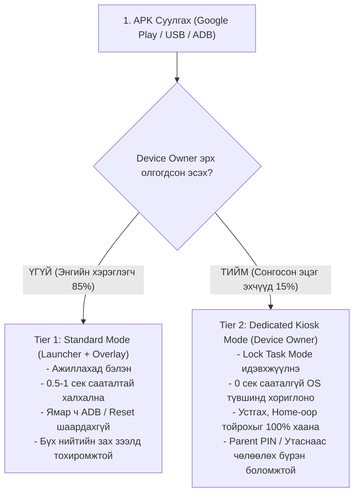

# FamilyScreen — Phase 10.3: Android Device Owner & Kiosk Mode Feasibility Report

**Огноо:** 2026-11-10  
**Аудит хийсэн:** Principal Systems, Android TV & Security Architect  
**Төлөв:** Техникийн судалгаа ба Архитектурын харьцуулалт бүрэн хийгдсэн (Feasibility & Comparative Study Complete)  
**Репозитор:** `https://github.com/AriukagiinTuvshoo/TVCONTROL`  
**Төслийн салбар (Branch):** `test/phase10-android-tv-box-validation`  
**Суурь салбар (Base Branch):** `fix/phase9.2-migration-safety` (Commit `77ee553`)  
**Кодын commit SHA:** `e9e1852`  
**Main салбарын төлөв:** `951a5dc` (Main салбар огт өөрчлөгдөөгүй, PR нээгээгүй, Phase 11 эхлээгүй)

---

## 1. Асуудлын Тодорхойлолт ба Зорилго (Problem Statement & Objective)

FamilyScreen төслийн одоогийн Android TV Box аппликейшн нь ердийн гуравдагч (third-party) апп хэлбэрээр ажилладаг. Гэвч хүүхдийн дэлгэцийн цаг болон апп хэрэглээг найдвартай хязгаарлах бодит орчинд дараах хоёр суурь дутагдал ажиглагддаг:

1. **Халхлах хугацааны саатал (0.5 – 1.0 секунд):**  
   Зөвшөөрөгдөөгүй апп (эсвэл BLOCK төлөвт орсон үед YouTube/Netflix) нээгдэх үед `UsageMonitoringService` нь 1 секундын давтамжтай шалгаж, FamilyScreen Launcher-ийг урд талд дууддаг (Overlay Takeover). Энэ хооронд хүүхэд 0.5–1 секундын турш хориглосон контентыг харах, дахин дахин дарж саатуулах боломжтой.
2. **Системийн түвшинд тойрох эрсдэл (Bypass Risks):**  
   Энгийн апп нь физик удирдлагын Home товчлуурыг системийн түвшинд бүрэн шүүх, бусад аппыг OS түвшинд шууд хаах (`forceStopPackage`), эсвэл өөрийгөө устгуулахаас (`DISALLOW_UNINSTALL_APPS`) 100% сэргийлэх эрхгүй байдаг.

**Энэхүү шинжилгээний зорилго:**  
FamilyScreen-ийг Android-ийн **Device Owner (Dedicated Device / Kiosk Mode)** горимд шилжүүлэх боломж, түүний давуу болон сул талууд, учирч болох техник хангамжийн эрсдэлүүд, аюулгүй байдлын онцгой дүрмүүдийг (эзэмшигчийн зөвшөөрөлгүй түгжихгүй байх зарчим) нарийвчлан судалж, эцсийн архитектурын шийдлийг гаргах.

---

## 2. Одоогийн Архитектурын Аудит (Architecture A Audit)

### 2.1. Бүрэлдэхүүн хэсгүүдийн үүрэг:
- [`AndroidManifest.xml`](file:///c:/Users/enhtv/Documents/tv%20control/android_tv_box/app/src/main/AndroidManifest.xml):
  `FamilyScreenLauncherActivity`-д `CATEGORY_HOME`, `CATEGORY_DEFAULT`, `CATEGORY_LEANBACK_LAUNCHER` зарлаж, Android TV-ийн Custom Home Launcher болж ажилладаг.
- [`UsageMonitoringService`](file:///c:/Users/enhtv/Documents/tv%20control/android_tv_box/app/src/main/java/mn/familyscreen/tv/service/UsageMonitoringService.kt):
  Android 14 (API 34)-ийн Foreground Service (`specialUse`) хэлбэрээр ажиллаж, 1000ms тутамд `UsageStatsManager.queryUsageStats()`-аар foreground package-ийг хянадаг. Хориглогдсон апп нээгдвэл `FLAG_ACTIVITY_NEW_TASK or FLAG_ACTIVITY_CLEAR_TOP` тугтайгаар Launcher-ийг дууддаг.
- [`BootPolicyRestoreReceiver`](file:///c:/Users/enhtv/Documents/tv%20control/android_tv_box/app/src/main/java/mn/familyscreen/tv/service/BootPolicyRestoreReceiver.kt):
  Төхөөрөмж асахад `BOOT_COMPLETED` эвентээр хяналтын сервисийг ажиллуулдаг.
- **Шаардагдах эрхүүд:** `PACKAGE_USAGE_STATS` (хэрэглээг хянах), `SYSTEM_ALERT_WINDOW` (дэлгэц дээр халхлах).

### 2.2. Хязгаарлалт ба Сул талууд:
- **Татгалзах (Proactive Block) хийж чаддаггүй:** Апп аль хэдийн нээгдсэний *дараа* (Reactive) л мэдээд буцааж дууддаг тул 0.5–1 секундын саатал гардаг.
- **Home товчны сул тал:** Хэрэв хэрэглэгч FamilyScreen-ийг үндсэн Launcher-аар "Always" гэж сонгоогүй эсвэл ТВ үйлдвэрлэгчийн систем Home товчийг өөрийн Store/Launcher луу хүчилдэг бол хүүхэд Home дараад 1 секундын хугацаанд системийн цэс рүү үсэрч болно.
- **Устгах эрсдэл:** Өсвөр насны хүүхэд Android Settings рүү орж FamilyScreen аппыг гараар устгах (`Uninstall`) боломжтой.

---

## 3. Device Owner & Kiosk Mode Техникийн Боломж (Architecture B)

Android 5.0 (API 21)+ Enterprise платформоос эхлэн нэвтэрсэн **Device Owner** нь тухайн төхөөрөмжийг бүхэлд нь удирдах эрхтэй цорын ганц администратор апп болдог.

### 3.1. Device Owner-ийн гол чадамжууд:
1. **Төгс Түгжээ буюу Lock Task Mode (Kiosk Mode):**
   - API: `dpm.setLockTaskPackages(adminComponent, arrayOf(packageName, "com.google.android.apps.youtube.kids"))`
   - Ажиллуулах: `activity.startLockTask()`
   - **Үр дүн:** Системийн түвшинд зөвхөн зөвшөөрөгдсөн аппууд л дэлгэцэнд гарах эрхтэй болно. Зөвшөөрөгдөөгүй аппыг нээх гэж оролдоход Android OS түүнийг огт асаахгүй (Zero-latency / 0 секундын сааталгүйгээр шууд татгалзана).
   - Home болон Recent Apps товчлуурууд автоматаар түгжигдэнэ (`LOCK_TASK_FEATURE_NONE` эсвэл `LOCK_TASK_FEATURE_HOME`).
2. **Байнгын Home Launcher болгох (Persistent Preferred Activity):**
   - API: `dpm.addPersistentPreferredActivity(adminComponent, filter, activityComponent)`
   - **Үр дүн:** Хэрэглэгчээс ямар нэгэн сонголт асуухгүйгээр FamilyScreen нь төхөөрөмжийн байнгын, өөрчлөх боломжгүй үндсэн дэлгэц болно.
3. **Хэрэглэгчийн үйлдлийг хязгаарлах (User Restrictions):**
   - `UserManager.DISALLOW_UNINSTALL_APPS`: FamilyScreen-ийг хэн ч устгаж чадахгүй.
   - `UserManager.DISALLOW_SAFE_BOOT`: Төхөөрөмжийг Safe Mode-оор асааж хамгаалалтыг тойрохоос сэргийлнэ.
   - `UserManager.DISALLOW_FACTORY_RESET`: Тохиргооноос төхөөрөмжийг дур мэдэн reset хийхийг хаана.
   - `UserManager.DISALLOW_MODIFY_ACCOUNTS`: Системийн Google дансыг өөрчлөхөөс сэргийлнэ.
4. **Аппыг шууд царцаах (Package Suspension):**
   - API: `dpm.setPackagesSuspended(adminComponent, arrayOf("com.android.tv.settings"), true)`
   - Системийн Settings-ийг түр хугацаанд идэвхгүй болгож сааралтуулах боломжтой.

### 3.2. Device Owner Суулгах ба Provisioning Шаардлага:
Device Owner болохын тулд Android үйлдлийн систем дараах хатуу шаардлагыг тавьдаг:
- **Урьдчилсан нөхцөл:** Төхөөрөмж дээр ямар ч Google Account, хувийн хэрэглэгчийн бүртгэл үүсгээгүй (цэвэр, шинэ эсвэл Factory Reset хийсэн) байх ёстой. Хэрэв данс бүртгэгдсэн бол `IllegalStateException` гарна.
- **ТВ Box дээр суулгах арга зам:**
  1. *QR Code / NFC Provisioning:* Ухаалаг утас шиг камер, NFC байхгүй тул ихэнх TV Box дээр ажиллахгүй.
  2. *ADB Provisioning (Бодит хэрэгжих арга):*
     ```bash
     adb shell dpm set-device-owner mn.familyscreen.tv/.receiver.TvDeviceAdminReceiver
     ```
     Нэг удаагийн ADB тушаалаар төхөөрөмжийн эзэмшигч болно.

---

## 4. Гурван Төрлийн Архитектурын Нарийвчилсан Харьцуулалт

| Шалгуур үзүүлэлт | А. Одоогийн Энгийн Апп (Launcher + Overlay) | В. Device Owner (Dedicated Kiosk Mode) | С. Үйлдвэрлэгчийн Систем Апп (OEM Platform Key / ROM) |
|---|---|---|---|
| **Хамгаалалтын түвшин (Security)** | Дунд (0.5-1 сек flickering сааталтай, устгах боломжтой) | **Маш өндөр (0 сек саатал, Lock Task, устгах боломжгүй)** | Төгс (Системийн цөм түвшинд удирдагдана) |
| **Хориглох найдвартай байдал** | Reactive (Нээгдсэний дараа хаана) | **Proactive (OS түвшинд нээхийг огт зөвшөөрөхгүй)** | Proactive (Үйлдвэрлэгчийн OS түвшинд) |
| **Суулгах хүндрэл (Installation)** | **Маш хялбар** (APK суулгаад шууд ажиллана) | Дунд (Нэг удаагийн ADB тушаал эсвэл цэвэр box шаардагдана) | Маш хүнд (Зөвхөн тухайн TV Box-ийн үйлдвэрт хийгдэнэ) |
| **Зах зээлийн нийцэл (Compatibility)** | **Бүх Android TV (8.0–14) дээр ажиллана** | **Бүх AOSP/Android TV дээр ADB-ээр дэмжигдэнэ** | Зөвхөн гэрээт нэг брэндийн TV Box дээр л ажиллана |
| **Home товчны удирдлага** | Хэрэглэгчийн сонголтоос хамаарна | **Системийн түвшинд бүрэн түгжигдэнэ** | Төгс түгжигдэнэ |
| **Алдаанаас сэргэх (Recovery)** | Аппыг шууд устгах боломжтой | **PIN код эсвэл ADB-ээр аюулгүй чөлөөлөх боломжтой** | Зөвхөн OEM firmware дахин шахаж засна |
| **Шинэчлэлт хийх (Maintenance)** | Хялбар | Хялбар (Silently update хийх давуу талтай) | Хүнд (OTA update шаардана) |

---

## 5. Аюулгүй Байдал, Эзэмшигчийн Зөвшөөрөл ба Буцаах Загвар (Safety & Recovery Design)

> [!CAUTION]
> **АЛТАН ЗАРЧИМ:**  
> **"Төхөөрөмжийг эзэмшигчийн зөвшөөрөлгүйгээр түгждэг систем хэзээ ч хийж болохгүй. Эцэг эхийн удирдлага, буцааж хэвийн болгох боломж хоёр заавал хамт байх ёстой."**

Хэрэв систем Device Owner горимыг дэмжихээр бол дараах 5 түвшний хамгаалалтын механизм заавал зэрэг хэрэгжинэ:

### 5.1. Зөвхөн Эцэг Эхийн Зөвшөөрлөөр Сонгох (Opt-in Enrollment):
- Апп суулгаад шууд автоматаар Device Owner болохгүй.
- Эхний горим нь энгийн **Standard Mode** байна.
- Хэрэв эцэг эх "Хүүхдийн өндөр хамгаалалттай Kiosk горим"-ыг хүсвэл гар утасны апп эсвэл дэлгэц дээр заавар харж, өөрсдийн сонголтоор ADB-ээр уг горимыг идэвхжүүлнэ.

### 5.2. Дэлгэцэн Дээрх Яаралтай Чөлөөлөлт (Parent PIN Emergency Exit):
- ТВ дэлгэц дээр 5 удаа дараалан буруу дарах, эсвэл удирдлагын тусгай хослол (жишээ нь: `Back + Menu` 3 секунд дарах) хийхэд **"Эцэг Эхийн Яаралтай Гарах Цэс"** гарч ирнэ.
- Эцэг эхийн баталгаажсан 4-6 оронтой PIN кодыг оруулахад:
  ```kotlin
  activity.stopLockTask()
  // Түр хугацаанд төхөөрөмжийг хэвийн горимд оруулж, бүх цэсийг нээнэ
  ```

### 5.3. Гар Утаснаас Зайнаас Түгжээг Цуцлах (Remote Parental Unlock):
- Хэрэв хүүхэд төхөөрөмжийг ямар нэгэн байдлаар гацаасан, эсвэл ТВ дэлгэц хариу өгөхгүй бол эцэг эх өөрийн гар утасны Flutter апп-аас **"ТВ-ийн Kiosk түгжээг түр цуцлах"** командыг илгээнэ.
- Backend-ээс WebSocket / Sync-ээр дохио авч `UsageMonitoringService` нь `stopLockTask()` дуудна.

### 5.4. Device Owner-ийг Бүрэн Цуцлах API (Clean De-provisioning):
- Төхөөрөмжийг анхны хэвийн ТВ болгохын тулд заавал Factory Reset хийх албагүй.
- FamilyScreen-ийн тохиргоо дотор эцэг эхийн PIN кодыг баталгаажуулсны дараа шууд системийн API дуудна:
  ```kotlin
  val dpm = getSystemService(Context.DEVICE_POLICY_SERVICE) as DevicePolicyManager
  dpm.clearDeviceOwnerApp(packageName)
  // FamilyScreen өөрийн Device Owner эрхийг сайн дураар цуцалж, ердийн апп болно
  ```
- Мөн компьютерийн консолоос:
  ```bash
  adb shell dpm remove-active-admin mn.familyscreen.tv/.receiver.TvDeviceAdminReceiver
  ```

### 5.5. Техник Хангамжийн Recovery (Hardware Factory Reset):
- Хэрэв програм бүрэн гацсан тохиолдолд ч Android TV Box-ын техник товчлуур (Recovery товчлуур) болон Bootloader цэсээр дамжин `Wipe data / Factory reset` хийх боломж хэзээ ч хаагдахгүй.

---

## 6. Эцсийн Стратегийн Зөвлөмж (Final Architecture Recommendation)

### Зөвлөмж: **Хосолсон Шатлалт Загвар (Hybrid Dual-Tier Architecture)**

FamilyScreen-ийг зөвхөн нэг горимоор хязгаарлахгүй, дараах хосолсон шатлалаар хөгжүүлэхийг санал болгож байна:



### 6.1. Яагаад энэ шийдэл хамгийн зөв бэ?
1. **Хэрэглэгчийн саад бэрхшээл бага:** Энгийн хэрэглэгч ямар нэгэн тусгай ADB команд бичихгүйгээр аппыг шууд суулгаад Standard горимоор ашиглаж эхэлнэ.
2. **Өндөр шаардлагатай хэрэглэгчийн хүсэлт хангагдана:** 0.5–1 секундын цоорхойгүй, хүүхэд устгаж чадахгүй хатуу хамгаалалт хүссэн хэрэглэгчид Device Owner Kiosk горимыг сонгон ажиллуулна.
3. **Аюулгүй бөгөөд уян хатан:** Төхөөрөмж гацах, эзэмшигчээ түгжих эрсдэл тэг (0) болно.

---

## 7. Дараагийн Шатны Хөгжүүлэлтийн Төлөвлөгөө (Implementation Roadmap)

Энэхүү шийдлийг бодит код болгох алхмууд:

1. **`TvDeviceAdminReceiver.kt` үүсгэх:**
   `DeviceAdminReceiver` классыг өргөтгөж, `onEnabled`, `onDisabled`, `onLockTaskModeEntering` эвентүүдийг боловсруулах.
2. **`AndroidManifest.xml`-д Device Admin зарлах:**
   `<receiver>` болон `device_admin_policy.xml` мета-датаг аюулгүй зарлах.
3. **`KioskPolicyManager.kt` модуль нэмэх:**
   `startLockTask()`, `stopLockTask()`, `setLockTaskPackages()` логикийг төвлөрүүлж, Standard vs Kiosk төлөвийг автоматаар удирдах.
4. **Эцэг эхийн PIN ба Зайнаас Чөлөөлөх урсгалыг холбох:**
   PIN баталгаажуулалт болон утаснаас ирэх командыг `stopLockTask()`-тай уях.
5. **Бодит төхөөрөмж дээр шалгах:**
   Зөвхөн биет TV Box дээр туршиж, Kiosk горимын ажиллагааг эцэслэн баталгаажуулах.
