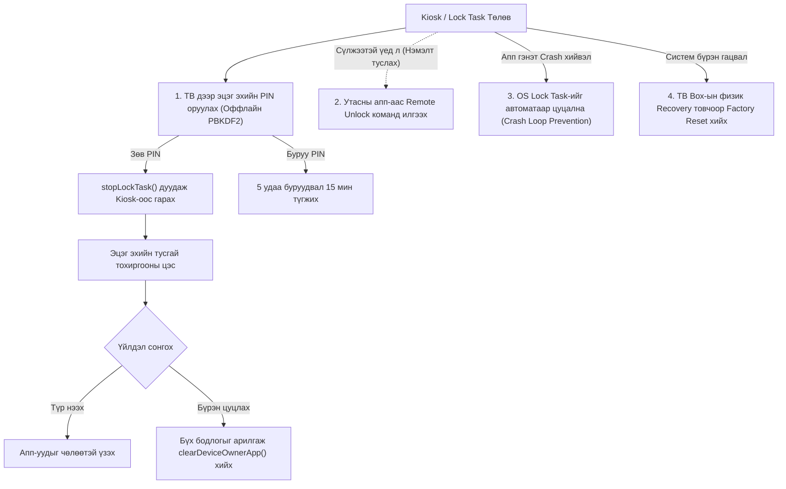
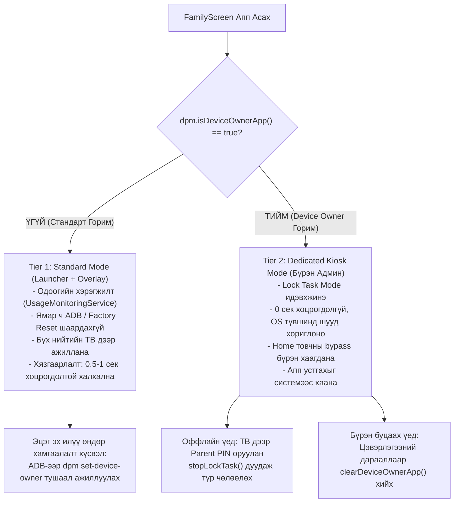

# FamilyScreen — Phase 10.4: Android Device Owner Technical Fact Verification Report

**Огноо:** 2026-11-10  
**Аудит хийсэн:** Principal Systems, Android TV & Security Architect  
**Төлөв:** Албан ёсны Android API ба кодын харьцуулсан баталгаажуулалт бүрэн хийгдсэн (Fact Verification & API Discrepancy Rectification Complete)  
**Репозитор:** `https://github.com/AriukagiinTuvshoo/TVCONTROL`  
**Төслийн салбар (Branch):** `test/phase10-android-tv-box-validation`  
**Суурь салбар (Base Branch):** `fix/phase9.2-migration-safety` (Commit `77ee553`)  
**Кодын commit SHA:** `c9cdcbb`  
**Main салбарын төлөв:** `951a5dc` (Main салбар огт өөрчлөгдөөгүй, PR нээгээгүй, Phase 11 эхлээгүй)

---

## 1. Ерөнхий Дүгнэлт ба Зорилго

Phase 10.3 тайланд дурдагдсан Android Enterprise, Device Owner болон Kiosk Mode-ийн тухай ойлголтуудыг Google Android-ийн албан ёсны эх сурвалж (Android Open Source Project ба Android Developers Documentation), бодит кодын бүтэцтэй тулган шалгаж, техникийн алдаатай таамаглалуудыг засаж залруулав.

> [!IMPORTANT]
> **ГОЛ ЗАРЧИМ:**  
> Device Owner нь Android үйлдлийн систем дэх хамгийн дээд түвшний захиргааны эрх бөгөөд алдаатай хэрэгжүүлбэл төхөөрөмжийг эзэмшигч өөрөө ашиглах боломжгүй болох ("soft-brick" / recovery wipe шаардагдах) өндөр эрсдэлтэй. Иймд таамаглалд бус, зөвхөн батлагдсан техникийн бодит баримтад тулгуурлан ажиллана.

---

## 2. Албан Ёсны Android API-уудын Бодит Баталгаажуулалт (API Investigation)

### 2.1. `DevicePolicyManager.setLockTaskPackages(admin, packages)`
- **Эрхийн шаардлага:** Зөвхөн Device Owner (эсвэл Profile Owner дээрх `DELEGATION_LOCK_TASK` төлөөлөгч) дуудах эрхтэй.
- **Бодит үйлдэл:** Lock Task горимд орох, эсвэл Lock Task горим ажиллаж байх үед дэлгэцэнд зэрэгцэн ажиллахыг зөвшөөрсөн багцуудын (allowlist) жагсаалтыг системд бүртгэнэ.
- **Залруулсан ташаа ойлголт:** Уг API нь зөвшөөрөгдсөн аппуудыг хооронд нь автоматаар асааж өгөхгүй. Апп хооронд шилжихэд стандарт Android Intent resolution, task affinity, `FLAG_ACTIVITY_NEW_TASK` зохицуулалтууд хэвийн үйлчилнэ.
- **Чухал анхааруулга:** Хэрэв whitelist-д орсон апп (жишээ нь YouTube Kids) өөрөө гадаад веб браузер дуудах, эсвэл Google Play Services акаунт нэвтрэлт шаардвал тухайн дэд сангууд whitelist-д байхгүй тохиолдолд систем уг үйлдлийг хүчээр таслана.

### 2.2. `Activity.startLockTask()` ба `Activity.stopLockTask()`
- **`startLockTask()`-ийн бодит байдал:**
  - Хэрэв тухайн апп `setLockTaskPackages()` жагсаалтад Device Owner-оор бүртгэгдсэн бол систем ямар ч анхааруулга асуухгүйгээр **чимээгүй (silent), шууд Kiosk түгжээнд** оруулна.
  - Хэрэв Device Owner эрхгүй, ердийн апп уг API-г дуудвал систем "App Pinning" горимд орж, дэлгэц дээр "Энэ аппыг бэхлэх үү? Буцах болон Тойм товчийг хамт дарж гаргана" гэсэн анхааруулга харуулдаг. Хүүхэд удирдлагын товчоор бэхлэлтийг шууд тайлах боломжтой.
- **`stopLockTask()`-ийн бодит байдал (Маш чухал залруулга):**
  - **Энэ функц нь Device Owner эрхийг ОГТ ЦУЦЛАХГҮЙ.**
  - Энэ нь зөвхөн тухайн Activity/Task-ийг түр хугацаанд Lock Task горимоос гаргаж, цонхны хэвийн горимд шилжүүлнэ.
  - Апп нь төхөөрөмжийн эзэмшигч хэвээрээ үлдэх бөгөөд дараагийн дуудлагаар дахин `startLockTask()` хийх бүрэн чадамжтай байна.

### 2.3. `DevicePolicyManager.clearDeviceOwnerApp(packageName)`
- **Бодит үйлдэл:** Тухайн аппликейшний Device Owner администратор статусыг бүрэн цуцална.
- **Буцалтгүй байдал (Irreversible):** Нэг удаа `clearDeviceOwnerApp()` дуудсан бол тухайн апп эргэж програмчлалын аргаар Device Owner болж **ЧАДАХГҮЙ**. Дахин уг горимд оруулахын тулд заавал ADB тушаал эсвэл Factory Reset хийх шаардлагатай болно.
- **Android 14+ (API 34) өөрчлөлт:** Google-ээс Android 14+ системд энэхүү аргыг deprecated болгож, байгууллагын системд зөвшөөрөлгүй менежментийг хаях явдлыг хязгаарлаж байна.
- **Цэвэрлэгээний шаардлага:** Уг API-г дуудахын өмнө өмнө нь тавьсан бүх `UserManager` хязгаарлалтууд (`DISALLOW_UNINSTALL_APPS` гэх мэт) болон `persistentPreferredActivity`-г дарааллын дагуу гараар цэвэрлэж байж цуцлах ёстой. Үгүй бол систем хэсэгчлэн түгжигдсэн төлөвт үлдэх аюултай.

### 2.4. `addPersistentPreferredActivity(admin, filter, activity)`
- **Бодит үйлдэл:** Төхөөрөмж дээр Home товч дарах үед ямар нэгэн "Always / Just Once" гэсэн асуулга гаргалгүйгээр FamilyScreen Launcher-ийг шууд байнгын default болгоно.
- **Цуцлах үйлдэл:** Буцаах үед заавал `clearPackagePersistentPreferredActivities(admin, packageName)` дуудаж цэвэрлэнэ.

---

## 3. Ташаа Ойлголтуудыг Залруулсан Дүн Шинжилгээ (Correction of Misconceptions)

| Асуулт / Таамаглал | Бодит Үнэн (Android Enterprise Truth) |
|---|---|
| **1. Whitelist-ийн аппууд хоорондоо чөлөөтэй нээгдэх үү?** | **ҮГҮЙ.** `setLockTaskPackages()` зөвхөн эрх олгоно. Аппууд бие даасан task тул `FLAG_ACTIVITY_NEW_TASK` болон зөв Intent filter байхгүй бол OS шилжилт хийхийг хориглож болзошгүй. |
| **2. `stopLockTask()` нь Device Owner эрхийг цуцлах уу?** | **ҮГҮЙ.** Зөвхөн Kiosk цонхны түгжээнээс гарна. Төхөөрөмжийн админ эрх хэвээр үлдэнэ. |
| **3. Энгийн PIN үйлдлээр Device Owner-ийг хялбар цуцалж болох уу?** | **ХАГАС.** `clearDeviceOwnerApp()` нь нэг талын буцалтгүй үйлдэл бөгөөд өмнөх бүх хязгаарлалтыг эхлээд системээс арилгах шаардлагатай. Хэрэглэгчид "Энэ үйлдлийг хийвэл дахин PC-ээр холбох шаардлагатай болно" гэдгийг тодорхой анхааруулах ёстой. |
| **4. Remote Unlock-д бүрэн найдаж болох уу?** | **ОГТ ҮГҮЙ.** ТВ оффлайн байх, Wi-Fi унах, эсвэл серверийн токен хүчингүй болсон үед Remote Unlock ажиллахгүй. Заавал ТВ дээрх **Локал PIN код шалгалт** анхдагч найдвартай аврах гарц байх ёстой. |
| **5. 85% / 15% зах зээлийн хувь үнэн үү?** | **ҮГҮЙ.** Энэ нь судалгаагаар нотлогдоогүй урьдчилсан таамаглал байсан тул баримт бичгээс бүрэн хасав. |
| **6. Factory Reset-ийг програм хангамжаар 100% хааж чадах уу?** | **ҮГҮЙ.** `DISALLOW_FACTORY_RESET` нь зөвхөн Android Settings цэсийн товчлуурыг хаана. ТВ Box-ын физик товчлуур/Reset нүхээр Bootloader Recovery руу орж өгөгдөл арчих үйлдлийг Android OS хэзээ ч хааж чадахгүй (мөн хаах ч ёсгүй). |

---

## 4. Оффлайн Орчинд Тэргүүн Ээлжинд Найдвартай Ажиллах Recovery Архитектур

Сүлжээ унасан үед ч төхөөрөмжийг хэвийн ашиглах боломжийг хангах 4 шатлалт найдвартай бүтэц:

### 4.1. Анхдагч Баталгаа (Primary Fail-Safe) — Локал Оффлайн PIN:
- Эцэг эхийн PIN кодын PBKDF2-HMAC-SHA256 hash нь `TvOfflineDatabase`-д (SharedPreferences `Context.MODE_PRIVATE`) хадгалагддаг.
- Сүлжээ огт байхгүй, Wi-Fi унтарсан, сервер унасан ч гэсэн ТВ-ийн удирдлагаар эцэг эхийн PIN-г шалгаж `activity.stopLockTask()` дуудах үйлдэл **100% оффлайн ажиллана**.

### 4.2. Апп унах үеийн хамгаалалт (App Crash & Loop Prevention):
- Хэрэв FamilyScreen нь Lock Task горимд байхдаа `UncaughtException` алдаа заан унавал Android үйлдлийн систем Lock Task-ийг автоматаар цуцалдаг.
- Дахин асах үед түгжээ дахин дахин унаж гацах (Crash Loop)-аас сэргийлэхийн тулд SharedPreferences-д "Сүүлийн 60 секундэд 3+ удаа унасан бол Kiosk горимыг алгасах" хамгаалалтын туг (Flag) байх ёстой.

### 4.3. Device Owner-ийг Аюулгүй Цуцлах Дараалал (Graceful De-provisioning):
Эцэг эх "Device Owner горимыг бүрэн болих" сонголт хийсэн үед систем дараах хатуу дарааллыг мөрдөнө:
1. `activity.stopLockTask()` (Цонхны түгжээнээс гарах)
2. `dpm.clearPackagePersistentPreferredActivities(admin, packageName)` (Default Launcher эрхээс татгалзах)
3. `dpm.setLockTaskPackages(admin, emptyArray())` (Allowlist-ийг хоослох)
4. `dpm.clearUserRestriction(admin, UserManager.DISALLOW_UNINSTALL_APPS)` (Устгах эрхийг нээх)
5. `dpm.clearUserRestriction(admin, UserManager.DISALLOW_SAFE_BOOT)` (Safe mode эрхийг сэргээх)
6. `dpm.clearDeviceOwnerApp(packageName)` (Админ эрхийг албан ёсоор буцаах)

---

## 5. Android TV Үйлдлийн Системийн Нийцлийн Матриц (API 26–35)

| Үйлдлийн Системийн Төрөл | Device Owner Provisioning (ADB) | Lock Task Mode | Persistent Preferred Launcher | Мэдэгдэж буй эрсдэл / Онцлог |
|---|---|---|---|---|
| **AOSP / Generic Android TV (API 26–34)** *(Amlogic, Allwinner, Rockchip)* | **Бүрэн дэмжигдэнэ** | **Бүрэн дэмжигдэнэ** | **Бүрэн дэмжигдэнэ** | Зарим хямд box-уудад factory recovery товчлуурын байрлал тодорхойгүй байж болно. |
| **Google TV / Chromecast (API 30–34)** | **Дэмжигдэнэ** (Гэхдээ Google account-гүй үед) | **Дэмжигдэнэ** | **Дэмжигдэнэ** | Google TV UI өөрийн launcher-аа хүчлэх хандлагатай. `setLockTaskFeatures` ашиглах шаардлагатай. |
| **Xiaomi Mi Box / Stick (PatchWall OS)** | **Дэмжигдэнэ** (ADB Security шаардана) | **Дэмжигдэнэ** | **Дэмжигдэнэ** | Xiaomi-ийн эрчим хүчний хэмнэлтийн алгоритм арын сервисийг унтраах эрсдэлтэй. |
| **Nvidia Shield TV (Android TV 9/11)** | **Бүрэн дэмжигдэнэ** | **Бүрэн дэмжигдэнэ** | **Бүрэн дэмжигдэнэ** | Стандарт Android Enterprise бүрэн суусан тул тогтвортой. |
| **Amazon Fire TV (Fire OS 7/8)** | **ТОДОРХОЙГҮЙ / ДЭМЖИГДЭХГҮЙ** | **Хязгаарлагдмал** | **Блоклогдсон** | Amazon өөрийн K Bahamas/Home-оос өөр launcher-ийг persistent болгохыг OS түвшинд хаасан. |

---

## 6. Залруулсан Эцсийн Архитектурын Загвар (Verified Hybrid Architecture)

---

## 7. Дараагийн Шатны Хэрэгжүүлэлтийн Дараалал (Recommended Roadmap)

Device Owner горимыг буруу хийвэл эрсдэл өндөр тул дараах үе шаттайгаар хэрэгжүүлнэ:

1. **Phase 10.5 — Бодит ТВ Box дээр Standard Mode-ийг турших:**  
   Юун түрүүнд одоогийн бэлэн болсон Standard Mode (Launcher + Overlay)-ийг бодит ТВ Box дээр ажиллуулан, суурь холболт, сүлжээ, D-Pad ажиллагааг баталгаажуулах.
2. **Phase 10.6 — `TvDeviceAdminReceiver` болон KioskPolicyManager нэмэх:**  
   Device Owner-ийг албадлагагүйгээр (opt-in), зөвхөн админ эрхтэй үед л идэвхждэг модулиар бэлтгэх.
3. **Phase 10.7 — Оффлайн Recovery ба De-provisioning туршилт:**  
   Эзэмшигчээ түгжихгүй байх бүх гарц, оффлайн PIN шалгалт, `clearDeviceOwnerApp` дарааллыг лабораторийн орчинд тестлэх.
