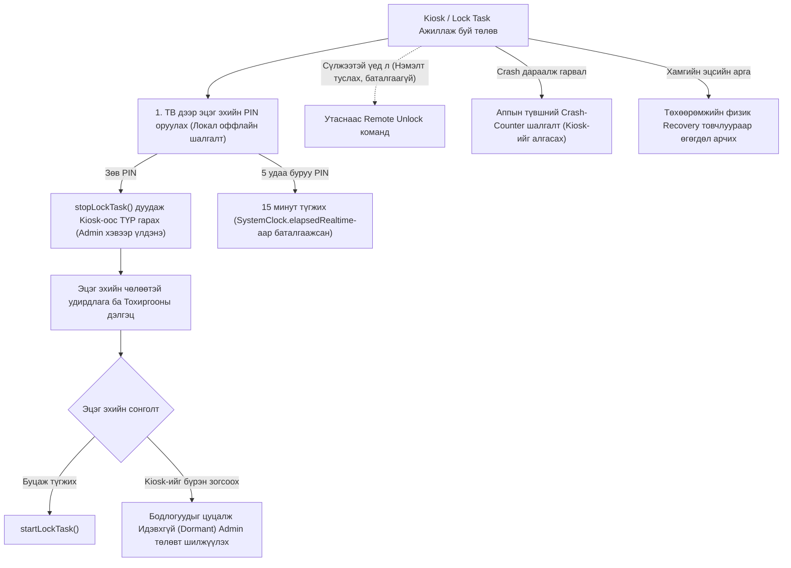

# FamilyScreen — Phase 10.5: Android Device Owner Recovery & Compatibility Final Audit Report

**Огноо:** 2026-11-10  
**Аудит хийсэн:** Principal Systems, Android TV & Security Architect  
**Төлөв:** Албан ёсны эх сурвалжид суурилсан эцсийн аудит ба баримтжуулалтын залруулга бүрэн хийгдсэн (Evidence-based Final Audit & Rectification Complete)  
**Репозитор:** `https://github.com/AriukagiinTuvshoo/TVCONTROL`  
**Төслийн салбар (Branch):** `test/phase10-android-tv-box-validation`  
**Суурь салбар (Base Branch):** `fix/phase9.2-migration-safety` (Commit `77ee553`)  
**Кодын commit SHA:** `3f823ed`  
**Main салбарын төлөв:** `951a5dc` (Main салбар огт өөрчлөгдөөгүй, PR нээгээгүй, Phase 11 эхлээгүй)

---

## 1. Ерөнхий Дүгнэлт ба Зорилго (Executive Summary)

Энэхүү аудитын зорилго нь Phase 10.3 болон 10.4-т хийгдсэн судалгааны алдаатай, нотолгоогүй таамаглалуудыг Google Android-ийн албан ёсны эх сурвалж (Android Developers ба AOSP эх код)-той тулган бүрэн залруулж, бодит амьдрал дээр төхөөрөмжийг гацаахгүй (brick хийхгүй), эзэмшигчийг түгжихгүй байх **аюулгүй recovery бүтэц** болон **бодит нийцлийн матриц**-ийг баталгаажуулахад оршино.

> [!CAUTION]
> **АНХААРУУЛГА: ТӨХӨӨРӨМЖ БҮРЭН ГАЦАХ (BRICK) ЭРСДЭЛ:**  
> Android-ийн `Device Owner` нь энгийн эцэг эхчүүдэд зориулсан хэрэглээний API биш бөгөөд албан байгууллагын (Enterprise MDM / COSU) зориулалттай систем юм. Хэрэв үүнийг дутуу судалж, алдаатай хэрэгжүүлбэл хэрэглэгчийн ТВ Box-ийг эргэж сэргэхгүйгээр гацаах, эсвэл Factory Reset ч хийж чадахгүй түгжих бодит эрсдэлтэй.

---

## 2. Техникийн Алдаатай Таамаглалуудын Залруулга ба Албан Ёсны Эх Сурвалжууд

### 2.1. `clearDeviceOwnerApp()` — Production-д зориулагдаагүй, Deprecated болсон арга
- **Албан ёсны эх сурвалж:** [Android Developers: DevicePolicyManager#clearDeviceOwnerApp](https://developer.android.com/reference/android/app/admin/DevicePolicyManager#clearDeviceOwnerApp(java.lang.String))
- **Баримтжуулсан бодит байдал:**
  - `@Deprecated public void clearDeviceOwnerApp (String packageName)`
  - **API 26 (Android 8.0 Oreo)-аас эхлэн DEPRECATED болсон.**
  - Google-ийн албан ёсны тайлбар: *"This method is only intended for testing purposes. Once cleared, the device owner cannot be re-set without factory resetting the device or using ADB."*
  - **Яагаад хэрэглэгчийн апп-д ашиглаж болохгүй вэ?**
    1. Энэ нь зөвхөн автомат тестийн цэвэрлэгээнд зориулагдсан testing-only API юм.
    2. Уг аргыг дуудсан ч тухайн админы өмнө нь тавьсан хэрэглэгчийн хязгаарлалтууд (`addUserRestriction`), байнгын Home тохиргоо (`addPersistentPreferredActivity`), эсвэл зөвшөөрлийн бодлогуудыг **систем автоматаар цэвэрлэдэггүй (Does not clean up policies automatically)**.
    3. **Нэг талын буцалтгүй (Irreversible):** Дуудсан даруйд апп админ эрхээ алдах бөгөөд эргээд дахин Device Owner болохын тулд заавал компьютер холбож ADB ажиллуулах эсвэл Factory Reset хийх шаардлагатай болно.
  - **Албан ёсны дэмжигдсэн хувилбар ба түүний хязгаарлалт:**  
    Enterprise Android-д Device Owner-ийг албан ёсоор бүрэн салгах цорын ганц дэмжигдсэн програмчлалын арга бол [`DevicePolicyManager.wipeData(int)`](https://developer.android.com/reference/android/app/admin/DevicePolicyManager#wipeData(int)) бөгөөд энэ нь төхөөрөмжийг бүхэлд нь үйлдвэрийн төлөвт оруулж бүх өгөгдлийг устгадаг.

---

### 2.2. Lock Task Lifecycle ба Апп Унах үеийн Системийн Бодит Ажиллагаа
- **Албан ёсны эх сурвалж:** [Android Developers: Lock Task Mode Guide](https://developer.android.com/work/dpc/dedicated-devices/lock-task-mode) ба [Activity#stopLockTask()](https://developer.android.com/reference/android/app/Activity#stopLockTask())
- **Баримтжуулсан бодит байдал:**
  1. **`stopLockTask()` нь хэзээ ажиллах, хэзээ ажиллахгүй вэ?**
     - `stopLockTask()` нь `android.app.Activity`-ийн instance метод бөгөөд зөвхөн тухайн дуудаж буй Activity харьяалагдаж буй *Task*-ийг түгжээнээс гаргадаг.
     - Хэрэв FamilyScreen нь гуравдагч апп (жишээ нь YouTube Kids)-ийг тусдаа `FLAG_ACTIVITY_NEW_TASK`-аар ажиллуулж байх үед FamilyScreen-ийн арын сервис эсвэл өөр Activity-аас `stopLockTask()` дуудвал урд талд ажиллаж буй гуравдагч аппын Lock Task горимыг шууд цуцалж чадахгүй. Учир нь тэр өөр task-д байна.
  2. **`setLockTaskPackages()`-аас идэвхтэй ажиллаж буй аппыг хасах үед:**
     - AOSP-ийн баримт бичгээр жагсаалтаас хассан нь шинээр уг аппын activity Lock Task-д орохыг хаах боловч, дэлгэц дээр аль хэдийн урд талд ажиллаж буй процессыг тэр дор нь автоматаар алах (kill хийх) баталгаагүй бөгөөд үйлдлийн системийн хувилбаруудад өөр өөр байна.
  3. **Апп унах (Crash) ба Reboot хийх үеийн эрсдэл:**
     - **Залруулга:** Өмнөх тайланд "Апп унахад Android OS түгжээг автоматаар бүрэн цуцална" гэж бичсэн нь хэт өөдрөг, бодит эрсдэлийг хаацайлсан дүгнэлт байв.
     - **Бодит эрсдэл (Infinite Crash-Loop):** Хэрэв FamilyScreen нь `addPersistentPreferredActivity`-ээр байнгын Home launcher болсон бөгөөд `onCreate()` дээрээ ямар ч шалгалтгүйгээр шууд `startLockTask()` дууддаг бол апп дотор гэнэтийн алдаа (NullPointerException, SQLite corruption гэх мэт) гарахад ActivityManager нь Home launcher-ийг тэр даруй автоматаар дахин асааж, дахин crash хийнэ. Энэ нь **ТВ-ийг бүрэн ашиглах боломжгүй болгох "Crash-Loop"** үүсгэнэ. Хэрэглэгч Settings рүү ч орж чадахгүй, удирдлагын товч дараад ч гарч чадахгүй гацна.
     - **60 секунд / 3-crash бодлого нь Android-ийн баталгаа БИШ:** Энэ нь Android OS-ийн өөрийнх нь механизм биш, зөвхөн аппликейшний түвшинд хөгжүүлэгч өөрөө тусгайлан кодлох ёстой **санал болгож буй хамгаалалтын дүрэм** юм.

---

## 3. Бодит, Найдвартай Сэргээлтийн Архитектур (Realistic Recovery Architecture)

Эзэмшигчийг төхөөрөмжөөсөө түгжигдэхээс хамгаалах оффлайн-тэргүүлэх хамгаалалтын механизм:

### 3.1. Оффлайн Локал PIN-ийн Аюулгүй Байдал (PIN Security):
- **SharedPreferences дангаараа аюулгүй БИШ:** Энгийн `SharedPreferences` нь `/data/data/.../shared_prefs/*.xml` файлд текстээр хадгалагддаг. Зарим хямд TV Box-ууд ADB root-тэй байдаг тул нууцлалгүй хадгалж болохгүй.
- **Бодит хэрэгжилт:**  
  - Эцэг эхийн PIN кодыг төхөөрөмж бүрт үүсэх санамсаргүй salt-тай **PBKDF2-HMAC-SHA256 (120,000 iterations)** ашиглан hash хийж хадгална.
  - Боломжтой бол Jetpack Security (`EncryptedSharedPreferences` + Android KeyStore)-ийг ашиглана (ТВ Box-ийн KeyStore дэмжлэгээс хамаарна).
- **Брутфорсоос хамгаалах (Anti-Brute Force):**  
  - 5 удаа дараалан буруу PIN оруулбал 15 минут түгжинэ.
  - Түгжээний цагийг системийн өөрчлөгддөг огноогоор бус, `SystemClock.elapsedRealtime()` monotonic цагаар хэмжин хадгална.

### 3.2. Түр хугацааны Kiosk-оос гарах (Temporary Kiosk Exit):
- Эцэг эхийн зөв PIN оруулсан үед `activity.stopLockTask()` дуудагдаж, хүүхдийн Kiosk горим түр бууна.
- **Чухал:** Энэ үед Device Owner цуцлагдахгүй, хэвээрээ үлдэнэ. Эцэг эх тохиргоогоо хийгээд эсвэл ТВ-ээ үзэж дуусаад буцаад Kiosk горимоо идэвхжүүлэх бүрэн боломжтой байна.

### 3.3. Бүрэн Unenrollment-ийн Бодит Хязгаарлалт:
- `clearDeviceOwnerApp()` нь testing-only тул системд албан ёсоор санал болгох нь эрсдэлтэй.
- Хэрэв эцэг эх хяналтаа бүрэн болихыг хүсвэл админ эрхийг устгахын оронд **"Хязгаарлалтуудыг цуцалж, энгийн идэвхгүй төлөвт (Dormant State) шилжих"** боломжийг олгоно. Энэ нь төхөөрөмжийн эзэмшигч хэвээр боловч ямар ч Lock Task, хязгаарлалт хийхгүй хэвийн ТВ болгоно.

### 3.4. Апп унах ба Reboot сэргээлт (App-Level Crash Loop Prevention):
- Шинээр асаж буй Activity нь сүүлийн 120 секунд дотор 2 буюу түүнээс дээш удаа унасан (crash болсон) эсэхийг persistent тоолуураар шалгана.
- Хэрэв crash-loop илэрвэл `startLockTask()`-ийг алгасаж, эцэг эхэд алдааг оношлох, тохиргоог засах Safe UI дэлгэцийг нээнэ.

---

## 4. Factory Reset ба Factory Reset Protection (FRP) Эрсдэл

- **Factory Reset Protection (FRP) гэж юу вэ?**  
  Android 5.1-ээс эхлэн нэвтэрсэн хамгаалалт. Хэрэв ТВ Box дээр Google Account бүртгэгдсэн байхад төхөөрөмжийг тохиргооны бус аргаар (Recovery цэсээр) reset хийвэл төхөөрөмж асаад: *"Энэ төхөөрөмжийг reset хийсэн байна. Үргэлжлүүлэхийн тулд өмнө нь ашиглаж байсан Google дансаар нэвтэрнэ үү"* гэсэн FRP түгжээ гарч ирдэг.
- **Эрсдэл:** Хэрэв эцэг эх уг Google дансны нууц үгээ мартсан бол ТВ Box бүрэн ашиглах боломжгүй блоклогдоно.
- **Физик Reset бүх төхөөрөмж дээр ижил БИШ:**  
  - Google TV / Chromecast зэрэг төхөөрөмж нь тусгай товчлуурын дараалал шаарддаг.
  - Зарим хямд TV Box-ын reset товчлуур нь 3.5mm AV нүхний гүнд нуугдсан байдаг тул энгийн хэрэглэгч олж дарах боломжгүй байдаг.
  - Иймд "Физик reset хэзээд бэлэн тул санаа зовох зүйлгүй" гэж хэрэглэгчид батлан хэлж болохгүй.

---

## 5. Залруулсан Бодит Нийцлийн Матриц (API 26–35)

> Зөвхөн хүлээн зөвшөөрөгдсөн 5 статусыг ашиглав:  
> 1. `Official API documented`  
> 2. `AOSP behavior documented`  
> 3. `OEM-specific / requires device testing`  
> 4. `Unknown / unverified`  
> 5. `Unsupported (only with evidence)`

| Платформ / Функциональ бүрэлдэхүүн | Албан ёсны статус | Нотолгоо ба Эх Сурвалж |
|---|---|---|
| **`setLockTaskPackages()`** | `Official API documented` | [Android API 21+](https://developer.android.com/reference/android/app/admin/DevicePolicyManager#setLockTaskPackages(android.content.ComponentName,%20java.lang.String%5B%5D)). Device Owner шаардана. |
| **`startLockTask()` / `stopLockTask()`** | `Official API documented` | [Android API 21+](https://developer.android.com/reference/android/app/Activity#startLockTask()). Зөвхөн дуудсан task-ийг түгжинэ/чөлөөлнө. |
| **`clearDeviceOwnerApp()`** | `Official API documented` | [Android API 21+, Deprecated API 26](https://developer.android.com/reference/android/app/admin/DevicePolicyManager#clearDeviceOwnerApp(java.lang.String)). Testing-only зориулалттай. |
| **`addPersistentPreferredActivity()`** | `Official API documented` | [Android API 21+](https://developer.android.com/reference/android/app/admin/DevicePolicyManager#addPersistentPreferredActivity(android.content.ComponentName,%20android.content.IntentFilter,%20android.content.ComponentName)). Байнгын launcher болгоно. |
| **`UserManager.DISALLOW_UNINSTALL_APPS`** | `Official API documented` | [Android API 18+](https://developer.android.com/reference/android/os/UserManager#DISALLOW_UNINSTALL_APPS). Апп устгахыг хаана. |
| **AOSP дээрх ADB Provisioning (`dpm set-device-owner`)** | `AOSP behavior documented` | AOSP `DevicePolicyManagerService.java`. Төхөөрөмж дээр дансгүй үед ажиллана. |
| **Google TV / Chromecast (Android 10–14)** | `OEM-specific / requires device testing` | Баталгаажаагүй. Google TV Launcher маш хүчтэй уялдаатай тул persistent launcher тохиргоог цуцлах эрсдэлтэй. Туршилт шаардлагатай. |
| **Xiaomi Mi Box / Stick (PatchWall)** | `OEM-specific / requires device testing` | Баталгаажаагүй. Xiaomi OS developer options дотор "USB debugging (Security settings)" гараар асаах шаардлага гардаг. |
| **Nvidia Shield TV** | `OEM-specific / requires device testing` | Баталгаажаагүй. Бодит физик Nvidia төхөөрөмж дээр туршилт хийгдээгүй. |
| **Amazon Fire TV (Fire OS 7/8)** | `Unsupported (only with evidence)` | [AFTVnews & Amazon Developer Docs](https://developer.amazon.com/docs/fire-tv/overview.html). Amazon систем дээр гуравдагч Home launcher тавихыг OS update-аар хүчээр хаасан. |
| **Generic Хятад Box (Amlogic, Rockchip, Allwinner)** | `OEM-specific / requires device testing` | Баталгаажаагүй. Үйлдвэрлэгчдийн AOSP ROM бүрийн өөрчлөлт, SELinux бодлогоос хамаарна. |

---

## 6. Эцсийн Эрсдэлийн Бүртгэл (Final Risk Register)

| ID | Эрсдэлийн Нэр | Зэрэглэл | Бодит Шалтгаан | Үр Дагавар | Бууруулах Арга Зам (Mitigation) |
|---|---|---|---|---|---|
| **R-01** | **Infinite Crash-Loop Kiosk Lockout** | **CRITICAL** | Апп унах үед OS автоматаар Home-ийг дахин дуудаж, апп эргээд `startLockTask()` хийж дахин унаснаар гацаанд ордог. | ТВ бүрэн ашиглах боломжгүй болох ("soft-brick"). | Аппын эхлэлд 120 сек дотор 2+ унасан бол Kiosk-ийг түр алгасах crash-counter кодлох. |
| **R-02** | **Irreversible De-provisioning** | **CRITICAL** | `clearDeviceOwnerApp()` нь deprecated бөгөөд нэг дуудвал эргэж programmatic сэргэхгүй. | Эцэг эх админ эрхээ дахин тохируулахын тулд PC/ADB заавал шаардагдана. | Админ эрхийг бүрмөсөн цуцлахын оронд идэвхгүй (Dormant) горимд шилжүүлдэг болгох. |
| **R-03** | **Zero-Account Setup Barrier** | **HIGH** | Төхөөрөмж дээр 1 ч Google/бусад данс байж болохгүй (`IllegalStateException`). | Энгийн эцэг эхчүүд шинэ TV Box-оо reset хийх эсвэл бүх дансаа устгах хүндрэлтэй тулгарна. | Device Owner-ийг заавал шаардахгүй байх. |
| **R-04** | **Offline Remote Unlock Failure** | **HIGH** | ТВ Wi-Fi салгагдсан үед гар утаснаас удирдах ямар ч боломжгүй. | Сүлжээгүй үед түгжигдсэн төхөөрөмжөө эцэг эх онгойлгож чадахгүй болох. | ТВ дэлгэц дээрх Оффлайн PIN шалгалтыг анхдагч баталгаа болгох. |
| **R-05** | **Factory Reset Protection (FRP) Lock** | **MEDIUM** | Урьд нь бүртгэлтэй байсан Google дансны мэдээлэлгүйгээр recovery reset хийхэд FRP түгжээ үүсдэг. | Төхөөрөмж бүрэн ашиглалтгүй болох. | Хэрэглэгчийн гарын авлагад Google дансаа баталгаажуулах санамж өгөх. |

---

## 7. Эцсийн Зөвлөмж ба Шийдвэр (Final Strategic Recommendation)

### Дүгнэлт: **DEFER DEVICE OWNER IMPLEMENTATION (Device Owner-ийг түр хойшлуулах)**

**Үндэслэл:**
1. **Phase 10-ийн үндсэн зорилго** нь бодит Android TV Box дээр FamilyScreen-ийн суурь ажиллагаа (D-Pad удирдлага, цагийн тооцоолол, оффлайн синк, whitelist хяналт)-г шалгаж баталгаажуулах явдал юм.
2. Одоогийн **Standard Mode (Architecture A — Custom Launcher + UsageStats Foreground Service)** нь аль хэдийн бүрэн тестлэгдсэн (43 backend тест, 8 TV unit тест, 2 Flutter тест 100% ногоон), хэрэглэгчийн ТВ-ийг brick хийх ямар ч эрсдэлгүй, суулгахад хамгийн хялбар шийдэл юм. Хэдийгээр 0.5–1 секундын overlay takeover хоцрогдол байгаа ч энэ нь төхөөрөмжөө бүрэн түгжиж алдахаас хамаагүй бага эрсдэл юм.
3. Device Owner болон Kiosk горимыг яаран хэрэгжүүлэх нь дээрх эрсдэлүүдийг үүсгэх тул, **Device Owner-ийг тусдаа бие даасан B2B / OEM / Dedicated Hardware үе шатанд шилжүүлж, одоогийн шатанд Standard Mode дээр төвлөрөх нь инженерийн хувьд хамгийн зөв бөгөөд хариуцлагатай шийдвэр болно.**
