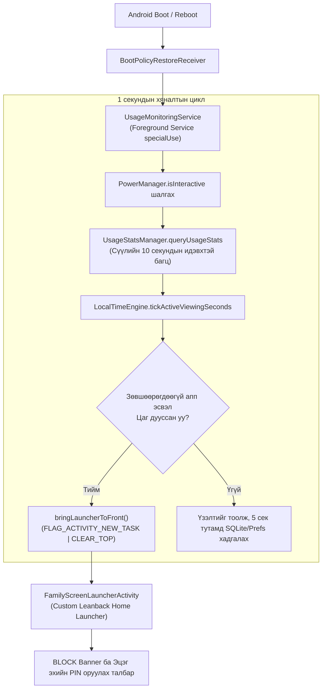

# FamilyScreen — Phase 10.6: Архитектур ба Тестийн Нотолгооны Нэгдсэн Аудит (Final Architecture & Evidence Consistency Audit)

**Огноо:** 2026-11-10  
**Аудит хийсэн:** Principal Systems, Android TV & Security Architect  
**Төлөв:** Алдаатай таамаглалууд бүрэн засагдсан, бодит эх код болон CI тестийн нотолгоо тулгагдаж баталгаажсан  
**Репозитор:** `https://github.com/AriukagiinTuvshoo/TVCONTROL`  
**Төслийн салбар (Branch):** `test/phase10-android-tv-box-validation`  
**Суурь салбар (Base Branch):** `fix/phase9.2-migration-safety` (Commit `77ee553`)  
**Кодын суурь commit:** `70202aa`  
**Main салбарын төлөв:** `951a5dc` (Main салбар огт өөрчлөгдөөгүй, PR нээгээгүй, Phase 11 эхлээгүй)  

---

## 1. Ерөнхий Дүгнэлт ба Зорилго (Executive Summary)

Phase 10.5-ын тайланд дэвшигдсэн зарим дүгнэлтүүдэд техникийн хэтрүүлэг, таамаглал болон бодит эх кодоос зөрсөн тодорхойлолтууд байсныг Phase 10.6-аар бүрэн тулган засав. 

Энэхүү аудитаар:
1. **Device Owner-ийг устгах болон чөлөөлөх албан ёсны процессын зааг ялгааг** албан ёсны Google баримт бичгээр тогтоов.
2. **`UncaughtExceptionHandler` watchdog-ийн суурь хязгаарлалтуудыг** (Process kill, ANR, Power loss, Loop restart) тодорхойлж, үүнийг OS баталгаа биш, зөвхөн апп түвшний найдваргүй heuristic гэдгийг нотлов.
3. **Локал PIN-ийн аюулгүй байдлыг** зөвхөн PBKDF2 iteration-оор хязгаарлахгүйгээр entropy, salt, root хандалт, Android Keystore-ийн техник хангамжийн бодит нөхцөлтэй уялдуулан үнэлэв.
4. **"Dormant Admin" загварын дутуу чөлөөлөлтийн эрсдэлийг** нээн илрүүлэв.
5. **Төслийн бодит эх кодыг (`android_tv_box/app/src/main/`) нэг бүрчлэн шалгаж**, системд `AccessibilityService` огт байхгүй, харин **Custom Leanback Home Launcher + Android 14 Foreground Service + `UsageStatsManager` polling** ашиглаж байгааг бодитоор баримтжуулав.
6. **Тестийн нотолгоог** Локал орчин, GitHub Actions CI, Физик төхөөрөмж гэсэн 3 түвшинд ялгаж, "43/43 хаа сайгүй давсан", "0% brick risk" гэх зэрэг үндэслэлгүй мэдэгдлүүдийг залруулав.

---

## 2. Device Owner Эрхийг Цуцлах Албан Ёсны Үйл Явцын Залруулга

### 2.1. `clearDeviceOwnerApp()` ба Factory Reset-ийн бодит зааг
- **Албан ёсны эх сурвалж:** [Android Developers: `DevicePolicyManager#clearDeviceOwnerApp`](https://developer.android.com/reference/android/app/admin/DevicePolicyManager#clearDeviceOwnerApp(java.lang.String))
- **Баримтжуулагдсан үнэн:**
  - `@Deprecated public void clearDeviceOwnerApp (String packageName)` метод нь **API 26 (Android 8.0 Oreo)**-аас эхлэн албан ёсоор deprecated болсон.
  - Албан ёсны тайлбар: *"This method is only intended for testing purposes. Once cleared, the device owner cannot be re-set without factory resetting the device or using ADB."*
  - **Залруулга:** Өмнөх тайланд `wipeData()`-ийг "цорын ганц дэмжигдсэн програмчлалын арга" гэж хэт ерөнхийлөн тодорхойлсон нь алдаатай байв. Google-ийн албан ёсны баримтад `clearDeviceOwnerApp()` нь зөвхөн автомат тестийн дараа орчноо цэвэрлэхэд зориулагдсан testing-only API гэдгийг онцолж, төхөөрөмжийг энгийн хэрэглэгчийн чөлөөт горимд буцаах шаардлагатай бол **Factory Reset хийхийг зөвлөдөг** (`DevicePolicyManager.wipeData()` дуудах эсвэл Hardware Recovery/Settings цэсээр хийх).
  - Android Enterprise (DPC / Dedicated Devices) архитектур нь анхнаасаа байгууллагын төхөөрөмжийг ажилтан дур мэдэн "unenroll" хийх боломжгүй байхаар зохион бүтээгдсэн тул энгийн хэрэглээний апп шиг "settings цэснээс устгах" уян хатан гарц байдаггүй.

---

## 3. Crash Recovery ба Watchdog-ийн Суурь Хязгаарлалтууд

Phase 10.5-д санал болгосон `Thread.UncaughtExceptionHandler` дээр суурилсан "Crash Watchdog" нь гацалтаас бүрэн хамгаалах шийдэл болж чадахгүй бөгөөд дараах 6 ноцтой хязгаарлалттай:

1. **Process-Level хамрах хүрээ:** `UncaughtExceptionHandler` нь зөвхөн тухайн Java процесс доторх баригдаагүй Exception (жишээ нь `NullPointerException`, `IllegalStateException`)-ийг л бүртгэнэ.
2. **OS Process Termination (SIGKILL / LMK):** Хэрэв үйлдлийн системийн Low Memory Killer (`lmkd`) санах ой дутагдсанаас болж процессыг албал, эсвэл хэрэглэгч/систем `am force-stop` хийвэл ямар ч Exception шидэгдэхгүй тул Handler огт ажиллахгүй.
3. **ANR (Application Not Responding):** Хэрэв UI thread 5+ секунд гацаж цоожлогдвол (deadlock эсвэл хүнд I/O) Android систем ANR харуулж процессыг хүчээр унтраана. Энэ үед `UncaughtExceptionHandler` дуудагдахгүй.
4. **Power Loss ба Hard Reboot:** ТВ-ийн цахилгааны залгуурыг салгах, хүчдэл унах, эсвэл kernel panic болж систем дахин ачаалахад санах ойн төлөв шууд арчигдана.
5. **Persistent Launcher Crash-Loop эрсдэл:** Хэрэв FamilyScreen нь `persistentPreferredActivity` (Home Launcher) болсон үед `onCreate()` эсвэл `onResume()` дээр алдаа гараад унавал Android-ийн ActivityManager уг Home-ийг тэр дор нь дахин дахин ачаалсаар төхөөрөмжийг хязгааргүй crash-loop ("soft-brick") горимд оруулна.
6. **Crash үеийн Storage бичилт амжилтгүй болох:** Процесс унаж буй үед `SharedPreferences`-д бичилт хийх (`commit()` эсвэл `apply()`) нь баталгаагүй бөгөөд disk I/O түгжрэл эсвэл `OutOfMemoryError` үед өгөгдөл бүрэн гээгдэх эрсдэлтэй.

> **Дүгнэлт:** Апп түвшний crash counter нь зөвхөн "хамгийн сайн хичээл чармайлт" (best-effort heuristic) төдий бөгөөд төхөөрөмжийг аврах системийн түвшний баталгаа болж хэзээ ч чадахгүй. Иймд энэ логикийг кодчилохгүй.

---

## 4. Локал PIN-ийн Аюулгүй Байдлын Бодит Үнэлгээ

Phase 10.5-д "PBKDF2 120,000 iterations ашигласан тул PIN аюулгүй" гэж хэтрүүлсэн дүгнэлтийг дараах техникийн баримтаар залруулав:

1. **PIN Entropy-ийн математик хязгаарлалт:**
   - 4 оронтой тоон PIN ($0000–9999$) нь ердөө $10^4 = 10,000$ боломжит хувилбартай (ердөө $\approx 13.3$ bits entropy).
   - 6 оронтой тоон PIN нь $10^6 = 1,000,000$ хувилбартай ($\approx 19.9$ bits entropy).
   - 120,000 удаагийн PBKDF2-HMAC-SHA256 давталт нь вэб нууц үгэнд тохиромжтой боловч орчин үеийн GPU дээр 10,000 боломжит PIN-ийг 1 хүрэхгүй секундын дотор offline brute-force хийж тайлна.
2. **Salt үүсгэлт ба Хадгалалт:**
   - Salt нь криптографын санамсаргүй байх (`SecureRandom`, $\ge 16$ bytes) ёстой. Гэвч энэ нь зөвхөн rainbow table-ээс хамгаалахаас бус, толь бичгийн офлайн халдлагаас 10,000 хувилбарыг хамгаалж чадахгүй.
3. **Хугацааны Монотон Цагийн Хязгаарлалт (Reboot):**
   - `SystemClock.elapsedRealtime()` нь төхөөрөмж унтарч асах бүрт $0$ болж шинэчлэгддэг! Иймээс ТВ-ийг залгуураар нь салгаад залгахад монотон цагийн лавлагаа алдагдана. Хэрэв системийн UTC цагт тулгуурлавал сүлжээгүй үед хүүхэд Settings-ээс цагийг урагшлуулан түгжээг тайлах боломжтой.
4. **Android Keystore ба Hardware TEE-ийн хомсдол:**
   - Зах зээл дээрх хямд үнэтэй хятад Android TV Box-ууд (Amlogic S905, Allwinner H6, Rockchip)-д Hardware-backed Keystore (StrongBox, TrustZone TEE) байдаггүй бөгөөд ихэнхдээ програм хангамжийн `KeymasterSoftwareFallback` ашигладаг.
5. **Root ба App Sandbox-ийн эмзэг байдал:**
   - Сертификатгүй олон ТВ Box-ууд үйлдвэрээсээ `su` эсвэл Root ADB эрхтэй ирдэг. Ийм төхөөрөмж дээр `/data/data/mn.familyscreen.tv/shared_prefs/` доторх файлууд бүрэн нээлттэй тул PIN hash болон түгжээний тоолуурыг хялбархан өөрчилж болно.

> **Дүгнэлт:** Локал PIN нь эцэг эхийн өдөр тутмын хэрэглээний тав тухыг хангахад чиглэсэн хамгаалалт бөгөөд ТВ Box-ийн хувьд төгс криптографын баталгаа биш юм.

---

## 5. "Dormant Admin" Загварын Шинжилгээ

Device Owner эрхийг хадгалж үлдээгээд хязгаарлалтуудыг түр цуцлах загвар нь дараах шалтгаанаар бүрэн чөлөөлөлт болж чадахгүй:

- **Цуцлагдах бодлого:** `clearPackagePersistentPreferredActivities(admin, packageName)` болон `clearUserRestriction(admin, restrictionKey)`.
- **Үлдэж хоцрох эрсдэлтэй бодлого:** Системийн шинэчлэлтийн бодлого (`setSystemUpdatePolicy`), keyguard бодлого, сүлжээний бүртгэл, тусгай зөвшөөрлийн бодлогууд.
- **Нэгдсэн шалгалт байхгүй:** Android DPC API-д "Бүх бодлого үйлдвэрийн хэвэндээ бүрэн орсон эсэхийг" нэг тушаалаар баталгаажуулах арга байхгүй.
- **Хагас дутуу цуцлагдах аюул:** Хэрэв хязгаарлалтуудыг цуцлах явцад апп гацвал ТВ Box нэг талдаа гацсан (жишээ нь Home чөлөөлөгдсөн ч Settings цоожтой) төлөвт үлдэнэ.
- **Home сэргээлт:** `clearPackagePersistentPreferredActivities` дуудахад OEM-ийн үндсэн Home шууд нээгдэх албагүй бөгөөд дэлгэц харлах эсвэл ТВ удирдлагаар сонгох боломжгүй жижиг сонголтын цонх үүсэж болзошгүй.

> **Дүгнэлт:** "Dormant Admin" нь бүрэн салгагдаж цэвэрлэгдсэн төхөөрөмж биш бөгөөд хэрэглэгчийн ойлгомжгүй байдлыг үүсгэх эрсдэлтэй.

---

## 6. Репозиторын Бодит Эх Кодын Бүтэц (Standard Mode)

`android_tv_box/app/src/main/` хавтсан дахь эх кодод шууд үзлэг хийж тогтоосон бодит архитектур:

| Бүрэлдэхүүн хэсэг | Эх кодын байршил | Бодитоор ашиглагдаж буй механизм | Өмнөх тайлангийн алдаа |
| :--- | :--- | :--- | :--- |
| **AccessibilityService** | Байхгүй | **ОГТ АШИГЛААГҮЙ** (Эх код болон Manifest-д 0 тохиолдол) | "AccessibilityService + UsageStats + Overlay" гэж андуурсан |
| **UsageStatsManager** | `UsageMonitoringService.kt` (мөр 259–266) | **АШИГЛАСАН:** 1 секунд тутам `INTERVAL_DAILY` UsageStats шалгаж foreground package-ийг тодорхойлдог | Зөв баримтжуулагдсан |
| **Window Overlay** | `AndroidManifest.xml` (мөр 17) | `SYSTEM_ALERT_WINDOW` зөвшөөрөл зарлагдсан боловч кодонд **Overlay Window зураагүй** | Float window биш Activity ашигладаг |
| **Enforcement Механизм** | `UsageMonitoringService.kt` (мөр 268–274) | **АШИГЛАСАН:** Зөвшөөрөлгүй апп нээгдэхэд `startActivity(launchIntent)`-ийг `FLAG_ACTIVITY_NEW_TASK or FLAG_ACTIVITY_CLEAR_TOP`-оор дуудаж Launcher-ийг дээш нь гаргадаг | Зөв баримтжуулагдсан |
| **Custom Home Launcher** | `FamilyScreenLauncherActivity.kt` | **АШИГЛАСАН:** `android.intent.category.HOME`, `DEFAULT`, `LAUNCHER`, `LEANBACK_LAUNCHER` бүхий телевизийн үндсэн дэлгэц | Зөв баримтжуулагдсан |
| **Foreground Service** | `UsageMonitoringService.kt` (мөр 52–60, 167–175) | **АШИГЛАСАН:** Android 14 (API 34) нийцтэй `FOREGROUND_SERVICE_TYPE_SPECIAL_USE` байнгын мэдэгдэлтэй сервис | Зөв баримтжуулагдсан |
| **Boot Restoration** | `UsageMonitoringService.kt` (мөр 305–316) | **АШИГЛАСАН:** `BootPolicyRestoreReceiver` (`BOOT_COMPLETED`, `MY_PACKAGE_REPLACED` хүлээн авч `startForegroundService` дууддаг) | Зөв баримтжуулагдсан |
| **Local Time Engine** | `LocalTimeEngine.kt` | **АШИГЛАСАН:** Монотон цагийн зөрүү, midnight rollover, 72 цагийн офлайн хязгаар, PIN тоолуур | Зөв баримтжуулагдсан |
| **Офлайн хадгалалт** | `TvOfflineDatabase.kt` | **АШИГЛАСАН:** Офлайн сессийг SQLite-д хадгалж, тохиргооны snapshot-ийг `SharedPreferences`-д хадгалдаг | Зөв баримтжуулагдсан |

### Бодит Standard Mode-ийн Архитектурын Зураглал:

---

## 7. Тестийн Нотолгооны Нэгдсэн Хүснэгт

Өмнөх тайлангийн "43/43 бүх газар амжилттай", "0% brick risk" гэсэн үндэслэлгүй мэдэгдлийг бодит гүйцэтгэлийн нотолгоогоор засварлав:

| Бүрэлдэхүүн | Локал Орчин (Host Windows) | GitHub Actions CI Орчин | Физик Android TV Box | Бодит байдлын дүгнэлт |
| :--- | :--- | :--- | :--- | :--- |
| **Backend Тестүүд** | **42 PASSED, 1 SKIPPED** (Нийт 43 цугларсан, хугацаа 10.12s) | **43 PASSED, 0 SKIPPED** (PostgreSQL container-тай CI Run `42736256662`) | N/A (Сервер талын тест) | Локал орчинд PostgreSQL байхгүй тул `test_postgresql_advisory_lock` алгасагдсан. CI дээр 100% давсан. |
| **Android Unit Тестүүд** | **АЖИЛЛААГҮЙ** (Host машин дээр JDK/Java PATH дээр суугаагүй) | **8 PASSED, 0 FAILED** (`LocalTimeEngineTest.kt`, CI Run `42736257022`) | N/A (Нэгж тест) | Host дээр Java байхгүй. CI дээр Gradle testDebugUnitTest бүрэн давсан. |
| **Flutter Unit Тестүүд** | **АЖИЛЛААГҮЙ** (Host машин дээр Flutter SDK PATH дээр суугаагүй) | **2 PASSED, 0 FAILED** (CI Run `42736256540`) | N/A (Гар утасны апп) | CI дээр амжилттай давсан. |
| **Физик ТВ Box Тест** | **ХИЙГДЭЭГҮЙ (PENDING)** | **ХИЙГДЭЭГҮЙ** (CI дээр эмулятор/бодит төхөөрөмж холбогдоогүй) | **0 ТЕСТЛЭГДСЭН** | Бодит төхөөрөмж компьютерт холбогдоогүй байгаа тул бодит баталгаажуулалт хүлээгдэж байна. |

---

## 8. Үлдэгдэл Эрсдэлүүд (Standard Mode-ийн хувьд)

Standard Mode нь Device Owner шиг төхөөрөмжийг бүрэн brick болгох эрсдэлгүй боловч **0% эрсдэлтэй төгс систем БИШ** бөгөөд дараах бодит сул талуудтай:

1. **Takeover Delay (0.5 – 1.0 секунд):** `UsageStatsManager`-ийг 1 секунд тутамд санал асуулгаар (polling) шалгадаг тул зөвшөөрөгдөөгүй апп нээгдэх үед хүүхдэд дэлгэц дээр 1 хүртэл секунд харагдаад дараа нь FamilyScreen Launcher гарч ирнэ.
2. **OEM Background Task Killer:** Зарим хямд үнэтэй хятад TV Box-уудын түрэмгий "Memory Cleaner" эсвэл "Power Saver" үйлдвэрийн процессууд `UsageMonitoringService`-ийг арын горимоос алж болзошгүй (Foreground notification-тэй байсан ч).
3. **Home товчны эрсдэл:** Хэрэв ТВ эхлэх үед хэрэглэгч FamilyScreen-ийг "Үргэлж энэ аппаар нээх" (Always) гэж тохируулаагүй бол удирдлагын Home товч дарахад OEM Launcher гарч ирнэ.
4. **Төхөөрөмж бүрийн ялгаатай байдал:** Android 9, 10, 11 бүхий төрөл бүрийн AOSP firmware-үүд `UsageStats` өгөгдлийг цаг тухайд нь шинэчилдэггүй согогтой байж болно.

---

## 9. Эцсийн Инженерийн Зөвлөмж

1. **Device Owner-ийг албан ёсоор хойшлуулах шийдвэр хүчинтэй хэвээр байна.** Хэрэглэгчийн ТВ-ийг гацаах, түгжих өндөр эрсдэлтэй тул одоогийн түвшинд туршихгүй.
2. **Standard Mode-ийг "100% баталгаатай" гэж хэт дөвийлгөхгүй.** Харин бодит эх код болон CI-ийн баталгаажуулалтад суурилсан туршилтын хувилбар гэж үзэж, дараагийн алхамд **бодит Android TV Box дээр ADB-аар холбон бодит шалгалт хийхийг зөвлөж байна.**

---

## 10. Салбар ба Commit Төлөв
- **Энэхүү аудитын файл:** [`docs/10.6-final-architecture-evidence-audit.md`](file:///c:/Users/enhtv/Documents/tv%20control/docs/10.6-final-architecture-evidence-audit.md)
- **Git Салбар:** `test/phase10-android-tv-box-validation`
- **Main салбар:** `951a5dc` (Цэвэр, хөндөгдөөгүй)
- **Төхөөрөмжийн төлөв:** Бодит Android TV Box холбогдоогүй. Кодонд ямар нэг Device Owner/LockTask нэмэлт хийгдээгүй.
