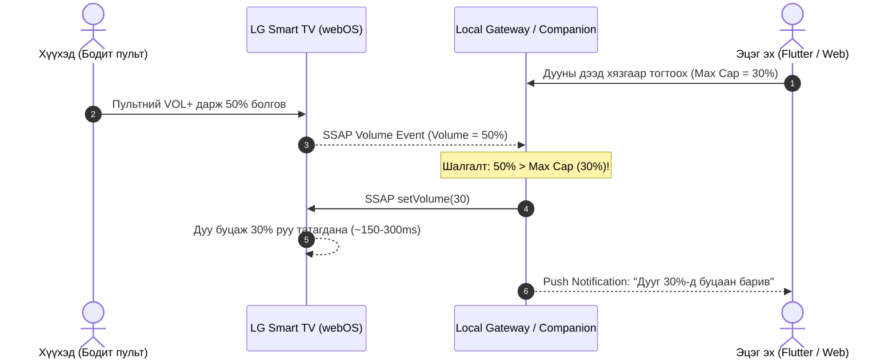

# FamilyScreen — 11. Universal TV Control & Multi-Platform Architecture Blueprint

**Хувилбар:** 2.0  
**Төлөв:** Батлагдсан Стратегийн Архитектур (Approved Engineering Blueprint)  
**Огноо:** 2026-11-10  
**Хариуцсан инженер:** Senior Software Architect, Security Engineer & Embedded Systems Lead  
**Төслийн репозитор:** `https://github.com/AriukagiinTuvshoo/TVCONTROL`  

---

## 1. Оршил ба Стратегийн Зорилго (Strategic Vision)

FamilyScreen төслийн анхны хувилбар (Phase 1–10.1) нь Android TV Box төхөөрөмж дээр **Device Owner / Kiosk Launcher** болон **Monotonic Anti-Tamper Local Time Engine** суурилуулж, хүүхдийн үзэх цагийг секунд бүрээр тасралтгүй хянадаг, тойрч гарах боломжгүй хатуу хяналтын системийг 100% амжилттай баталгаажуулсан.

Гэвч бодит амьдрал дээр айл өрхүүд зөвхөн Android TV ашигладаггүй:
- **Samsung Smart TV** (Tizen үйлдлийн системтэй, дэлхийн Smart TV-ийн ~25-30%)
- **LG Smart TV** (webOS үйлдлийн системтэй, дэлхийн Smart TV-ийн ~20-25%)
- **Android TV / Google TV** (Sony, TCL, Xiaomi, Chromecast)
- **Roku TV & бусад HDMI дэлгэцүүд**

Бүх зурагт дээр нэг ижил APK суулгах боломжгүй (Tizen нь WGT/Web App, webOS нь IPK/Web App, харин зарим ТВ нь хэрэглэгчийн гуравдагч талын апп суулгахыг зөвшөөрдөггүй хаалттай санbox-той).

Тиймээс FamilyScreen-ийн урт хугацааны үндсэн архитектурыг **"Universal TV Control & Parental Management"** болгон шатлан өргөжүүлж байна.

---

## 2. Гол Зарчим: Хоёр Шатлалт Хяналтын Бүтэц (Two-Tier Enforcement Architecture)

> [!IMPORTANT]
> **АЛТАН ДҮРЭМ:**  
> **"ТВ дээр нэмэлт апп суулгахгүйгээр сүлжээгээр боломжтой бүх удирдлагыг эхэлж ашиглана (Agentless First). Харин хүүхэд тойрч гарах боломжгүй цагийн хатуу хязгаарлалт, апп блоклоход зориулж төхөөрөмжийн өөрийн Launcher/Box-ийг ашиглана (Agent-Based Hardened)."**

```
┌──────────────────────────────────────────────────────────────────────────────┐
│                  FamilyScreen Parent Interfaces (Clients)                    │
│          [ Flutter Mobile App (iOS/Android) ]   +   [ PC Web Dashboard ]      │
└──────────────────────────────────────┬───────────────────────────────────────┘
                                       │ HTTPS / WSS / mDNS / SSDP
                                       ▼
┌──────────────────────────────────────────────────────────────────────────────┐
│                    FamilyScreen Unified Backend & Gateway                    │
│             FastAPI Core  •  PostgreSQL DB  •  Device Adapter Matrix         │
└───────┬──────────────────────────────┬────────────────────────────────┬──────┘
        │                              │                                │
        ▼ (Local Network / Wi-Fi)      ▼ (Agent Sync / REST)            ▼ (Cloud / IoT)
┌──────────────────────────────┐ ┌──────────────────────────────┐ ┌────────────────────┐
│   Tier 2: Agentless TV       │ │   Tier 1: Agent-Based TV     │ │ Cloud Integrations │
│  (Аппгүй сүлжээний удирдлага) │ │  (Тусгай Launcher & Engine)  │ │                    │
├──────────────────────────────┤ ├──────────────────────────────┤ ├────────────────────┤
│ • LG webOS (SSAP WS 3000)    │ │ • FamilyScreen Box (Kotlin)  │ │ • Samsung          │
│ • Samsung Tizen (WS 8001/2)  │ │ • Android TV App (Kotlin)    │ │   SmartThings REST │
│ • Android Remote Service v2  │ │                              │ │ • Google Home Cast │
│ • Roku ECP (HTTP 8060)       │ │ [Боломжууд]:                 │ │                    │
│ • Wake-on-LAN (UDP 9 Magic)  │ │ - 1-sec Monotonic Time Engine│ └────────────────────┘
│                              │ │ - Strict Whitelist Blocking  │
│ [Боломжууд]:                 │ │ - Red Lockout Overlay (Kiosk)│
│ - Дууны дээд хязгаар (Cap)   │ │ - 72h Offline Autonomous Mode│
│ - Дуу чангалах/суллах/хаах   │ │ - Child PIN Lockout System   │
│ - ТВ асаах / унтраах         │ └──────────────────────────────┘
│ - Апп нээх (Launch via DIAL) │
│ - Суваг/Оролт солих          │
└──────────────────────────────┘
```

---

## 3. Платформ Тус Бүрийн Технологийн Холболтын Матриц

### 3.1. LG Smart TV (webOS 3.0+)
- **Холболтын протокол:** WebSocket SSAP (`ws://<tv_ip>:3000/`)
- **Баталгаажуулалт (Pairing):** Апп анх холбогдоход ТВ дэлгэц дээр 8 оронтой PIN код эсвэл "Allow" prompt гарна. Зөвшөөрсний дараа `client-key` олгогдож, цаашид нууцлалтай хадгалагдана.
- **Боломжит үйлдлүүд (Апп суулгахгүйгээр):**
  - **Дуу тохируулах:** `ssap://audio/setVolume` (volume: 0..100)
  - **Дуу хаах/нээх:** `ssap://audio/setMute` (mute: true/false)
  - **Дууны түвшинг татах:** `ssap://audio/getVolume`
  - **ТВ унтраах:** `ssap://system/turnOff`
  - **Апп нээх:** `ssap://system.launcher/launch` (`id: "youtube.leanback.v4"`)
  - **ТВ асаах:** Wake-on-LAN (WoL) Magic Packet (LG webOS-ийн "LG Connect Apps / Mobile TV On" тохиргоо идэвхтэй үед).

### 3.2. Samsung Smart TV (Tizen 2016+)
- **Холболтын протокол:** Secure WebSocket (`wss://<tv_ip>:8002/api/v2/channels/samsung.remote.control?name=<encoded_name>&token=<token>`)
- **Баталгаажуулалт (Pairing):** ТВ дэлгэц дээр "FamilyScreen холбогдохыг зөвшөөрөх үү?" гэсэн pop-up гарч, хэрэглэгч зөвшөөрснөөр token олгогдоно.
- **Боломжит үйлдлүүд (Апп суулгахгүйгээр):**
  - **Түлхүүр илгээх (Key Emulation):** `KEY_VOLDOWN`, `KEY_VOLUP`, `KEY_MUTE`, `KEY_POWER`, `KEY_HOME`, `KEY_RETURN`.
  - **SmartThings REST API (Cloud fallback):** Хэрэв ТВ нь эцэг эхийн SmartThings бүртгэлтэй бол Cloud API-аар дамжуулан дууны түвшин тогтоох (`main/volume`), төлөв шалгах, унтраах.
  - **ТВ асаах:** Wake-on-LAN (Ethernet эсвэл WoWLAN).

### 3.3. Android TV / Google TV (Sony, TCL, Mi Box, Chromecast)
- **Холболтын протокол:** Android TV Remote Protocol v2 (TLS Port 6466/6467)
- **Баталгаажуулалт (Pairing):** ТВ дэлгэц дээр гарсан 4-6 оронтой нууц кодоор TLS Client Certificate солилцон хослоно.
- **Боломжит үйлдлүүд (Апп суулгахгүйгээр):**
  - Дуу тохируулах (`KEYCODE_VOLUME_UP`, `KEYCODE_VOLUME_DOWN`, `KEYCODE_VOLUME_MUTE`).
  - D-Pad сумтай удирдлага (`DPAD_UP`, `DPAD_DOWN`, `DPAD_LEFT`, `DPAD_RIGHT`, `DPAD_CENTER`).
  - ТВ унтраах (`KEYCODE_POWER`).
  - Google Cast (Chromecast protocol) ашиглан медиа тоглуулах/зогсоох.
- **2-р түвшний хатуу хяналт (FamilyScreen Agent суулгасан үед):**
  - Манай Kotlin Launcher & Local Time Engine ажиллаж, апп блоклох, цаг ухраахгүй байх, бүтэн дэлгэцийн түгжээг 100% хангана.

### 3.4. Roku TV & Universal UPnP/DLNA
- **Roku ECP (External Control Protocol):** HTTP POST `http://<roku_ip>:8060/keypress/VolumeDown`, `VolumeUp`, `PowerOff`.
- **UPnP / DLNA RenderingControl:** Зурагтын дууг сүлжээгээр хязгаарлах (`SetVolume` SOAP call).
- **Wake-on-LAN (WoL):** UDP Port 9 дээр 6 удаа `0xFF` болон 16 удаа ТВ-ийн MAC хаягийг агуулсан Magic Packet илгээн унтарсан ТВ-г сүлжээгээр асаана.

---

## 4. Гол Функц: Дууны Дээд Хязгаар Тогтоох (Volume Max Cap) ба Техникийн Хязгаарлалтууд

Хүүхдүүд зурагт үзэхдээ дууг нь 70–100% болгон чангалж, сонсголоо гэмтээх болон гэрийн амгалан тайван байдлыг алдагдуулдаг.

### 4.1. Платформын бодит боломжууд (Feasibility Audit Findings):
- **LG webOS (Хариу үйлдэлтэй хяналт):** `ssap://audio/getVolume` subscription-аар пультээр дуу өөрчлөгдөх эвентийг локал WebSocket-ээр шуурхай хүлээн авч, `setVolume(cap)` илгээж буцаан татах боломжтой. Сүлжээний хоцрогдол ~150-300ms байх бөгөөд хүүхэд VOL+ товч дээр хуруугаа салгахгүй дарсан үед дуу өсөж, эргэн буурах чичиргээ (volume bouncing) ажиглагдана.
- **Samsung Tizen (Локал WebSocket):** Локал холболт нь зөвхөн `KEY_VOLDOWN` товчлуур илгээдэг, одоогийн дууны хувийг унших боломжгүй тул локал сүлжээгээр шууд дууны хувийн дээд хязгаар барих боломжгүй. Харин SmartThings Cloud API ашиглавал дууг унших/бичих боломжтой боловч үүлэн хоцрогдол нь 1000–2500ms байна.
- **FamilyScreen Android TV Box Agent:** ТВ-ийн үйлдлийн системийн түвшинд `AudioManager`-ийг шууд барьдаг тул ямар ч сүлжээний хоцрогдолгүй (0-5ms), тойрч гарахгүй төгс хязгаарлана (Tamper-Resistant).

### 4.2. Reactive Volume Cap Логик (LG webOS & Gateway):
1. Эцэг эх гар утас эсвэл компьютерээсээ **"Зочны өрөөний ТВ: Дээд дуу = 30%"** гэж тохируулан түгжинэ (`volume_locked: true`).
2. **Local Volume Monitor Worker (Local Gateway / Mobile Companion):**
   - LG webOS: `ssap://audio/getVolume` (`subscribe: true`) хийж, дууны түвшний өөрчлөлтийг сонсоно.
3. Хэрэв хүүхэд ТВ-ийн бодит пультээр дууг 30%-иас ихэсгэж 50% болговол:
   - Монитор модуль WebSocket-ээр `ssap://audio/setVolume(30)` илгээж автоматаар буцааж 30% руу татна (Reactive Rollback).
   - Эцэг эхийн утсанд "Дууны дээд хязгаар хамгаалагдлаа" мэдэгдэл илгээнэ.
   - *Анхааруулга:* Хэрэв эцэг эхийн утас background горимд орж унтарвал (iOS background socket kill), гэрийн дотоод сүлжээнд байнга асаалттай Local Gateway байхгүй бол сүлжээний хяналт зогсоно.



---

## 5. PC Web Dashboard (Компьютерээс Нэгдсэн Удирдах Систем)

Эцэг эхчүүд ажил дээрээ эсвэл гэрийнхээ компьютер дээр ажиллаж байхдаа утсаа байнга шалгахгүйгээр компьютерээсээ бүх төхөөрөмжийг хянах боломжийг бүрдүүлнэ:

1. **Технологи:** Next.js / React (эсвэл Flutter Web), Tailwind CSS, WebSocket / SSE real-time sync.
2. **Гол боломжууд:**
   - **Multi-Screen Grid:** Гэрийн 3 зурагт (Зочны өрөө, Хүүхдийн өрөө, Гал тогоо)-ны төлөв зэрэг харагдана.
   - **One-Click Instant Lock:** Компьютерээс ганц товч дараад бүх дэлгэцийг унтраах / түгжих.
   - **Live Volume Sliders:** Зурагт тус бүрийн одоогийн дууг шууд өөрчлөх, Mute хийх, Max Cap түгжих.
   - **Time Quota Controls:** Өдрийн лимит болон үзэх цагийн хуваарийг том дэлгэц дээр хялбар тохируулах.
   - **Detailed Analytics:** Өдөр, 7 хоног, сарын хэрэглээний бүрэн хэмжээний диаграм, график харах.

---

## 6. Өгөгдлийн Сангийн Шинэчлэл (Schema Extensions)

Одоогийн `devices` хүснэгтэд зөрчил үүсгэхгүйгээр дараах талбаруудыг нэмж, шинэ `device_commands` хүснэгтийг нэвтрүүлнэ:

```sql
-- 1. devices хүснэгтийн өргөтгөл (Universal TV Control-д зориулсан)
ALTER TABLE devices 
  ADD COLUMN IF NOT EXISTS connection_mode VARCHAR(32) NOT NULL DEFAULT 'AGENT_NATIVE',
  ADD COLUMN IF NOT EXISTS network_ip VARCHAR(45),
  ADD COLUMN IF NOT EXISTS mac_address VARCHAR(17),
  ADD COLUMN IF NOT EXISTS auth_token_encrypted TEXT,
  ADD COLUMN IF NOT EXISTS is_powered_on BOOLEAN NOT NULL DEFAULT FALSE,
  ADD COLUMN IF NOT EXISTS current_volume INT DEFAULT 20,
  ADD COLUMN IF NOT EXISTS max_volume_cap INT NOT NULL DEFAULT 100,
  ADD COLUMN IF NOT EXISTS volume_locked BOOLEAN NOT NULL DEFAULT FALSE,
  ADD COLUMN IF NOT EXISTS supported_capabilities JSONB NOT NULL DEFAULT '["agent_limits"]'::jsonb;

-- 2. device_commands хүснэгт (Алсын удирдлагын тушаал, дараалал ба аудит)
CREATE TABLE IF NOT EXISTS device_commands (
    id UUID PRIMARY KEY DEFAULT gen_random_uuid(),
    device_id UUID NOT NULL REFERENCES devices(id) ON DELETE CASCADE,
    user_id UUID REFERENCES users(id) ON DELETE SET NULL,
    command_type VARCHAR(40) NOT NULL, -- POWER_ON, POWER_OFF, SET_VOLUME, SET_VOLUME_CAP, MUTE, UNMUTE, LAUNCH_APP, DPAD_KEY, INSTANT_LOCK
    payload JSONB NOT NULL DEFAULT '{}'::jsonb,
    status VARCHAR(20) NOT NULL DEFAULT 'PENDING', -- PENDING, SENT, ACKNOWLEDGED, FAILED
    error_message TEXT,
    created_at TIMESTAMPTZ NOT NULL DEFAULT NOW(),
    executed_at TIMESTAMPTZ
);

CREATE INDEX IF NOT EXISTS idx_device_commands_device_status ON device_commands(device_id, status);
```

---

## 7. Хэрэгжүүлэлтийн Алхам ба Архитектурын Залгаас (Phased Implementation Plan)

1. **Алхам 1 (Суурь баталгаажуулалт):** PRD v2.0 болон Системийн Архитектур v2.0-ийг төсөлд нэгтгэн, өгөгдлийн сангийн шилжүүлгийг бэлтгэх.
2. **Алхам 2 (Local Network Discovery):** Flutter гар утасны апп болон Backend дээр локал сүлжээн дэх ТВ-үүдийг автоматаар хайх (mDNS / SSDP) протоколын модулийг бичих.
3. **Алхам 3 (LG & Samsung Adapters):** WebSocket холболтоор дууны дээд хязгаар (Volume Cap) болон асаах/унтраах тушаалуудыг илгээдэг бие даасан Python / Dart сангуудыг холбох.
4. **Алхам 4 (Web Dashboard):** Компьютерээс төхөөрөмжүүдээ удирдах зориулалттай Responsive Web интерфэйсийг холбох.

> **Дүгнэлт:** Энэхүү архитектур нь өмнөх 10 шатанд хийгдсэн Android TV Box-ийн код, тест, аюулгүй байдлыг **100% хадгалан хамгаалж**, хажуугаар нь дэлхийн бусад Smart TV-үүдийг сүлжээгээр удирдах цоо шинэ чадварыг төсөлд бүрэн нэмж байна.
